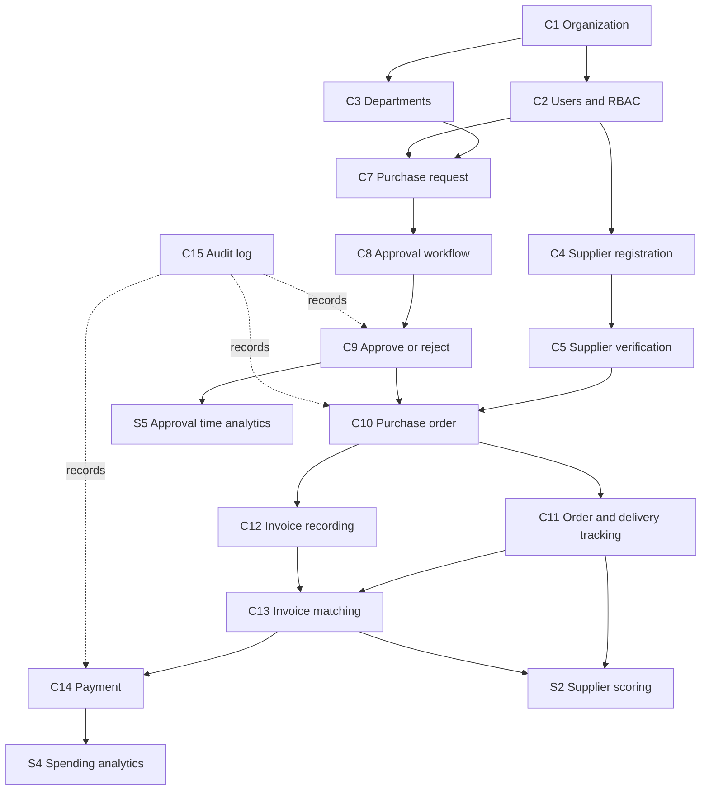
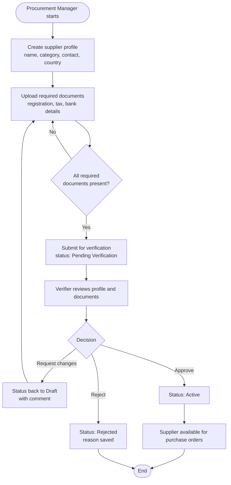
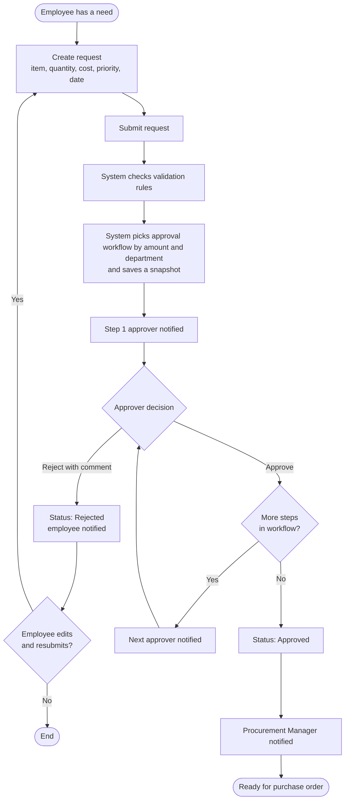
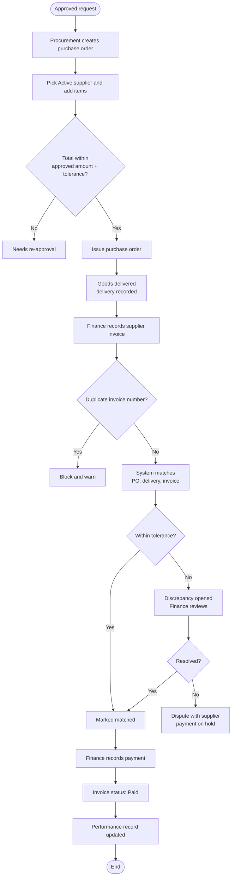

# 02. Product Feature Specification

## 2.1 Core vs Secondary Features

**Core features** are the ones without which the value chain breaks.
**Secondary features** improve the experience but the chain still works
without them.

### Core Features

| ID | Feature | Module |
|---|---|---|
| C1 | Organization and tenant setup | Platform |
| C2 | User invitation and role assignment (RBAC) | Platform |
| C3 | Department management | Platform |
| C4 | Supplier registration and profile | Supplier |
| C5 | Supplier verification and status management | Supplier |
| C6 | Supplier document upload | Supplier |
| C7 | Purchase request creation | Request |
| C8 | Configurable approval workflow | Approval |
| C9 | Approve / reject with comment | Approval |
| C10 | Purchase order creation from approved request | Order |
| C11 | Order status and delivery tracking | Order |
| C12 | Invoice recording | Finance |
| C13 | Invoice to purchase order matching | Finance |
| C14 | Payment recording | Finance |
| C15 | Audit log | Platform |

### Secondary Features

| ID | Feature | Module |
|---|---|---|
| S1 | In-app and email notifications | Platform |
| S2 | Supplier performance scoring | Intelligence |
| S3 | Supplier risk indicators | Intelligence |
| S4 | Spending analytics dashboards | Analytics |
| S5 | Approval time analytics | Analytics |
| S6 | Comments between employee and procurement | Request |
| S7 | Request delegation (when manager is away) | Approval |
| S8 | Data export (CSV) | Platform |

## 2.2 Role Capability Matrix

Legend: C = create, R = read, U = update, A = approve, X = no access.
"Own" means only their own records. "Dept" means their department.

| Capability | Owner | Procurement Mgr | Dept Mgr | Finance | Employee |
|---|---|---|---|---|---|
| Organization settings | CRU | X | X | X | X |
| Departments | CRU | R | R (own) | R | X |
| Invite users / assign roles | C | X | X | X | X |
| Configure approval rules | CRU | R | X | X | X |
| Suppliers | R | CRUA | R | R | X |
| Purchase requests | R | R | CR (Dept) + A | R | CR (Own) |
| Approve requests | Per rule | Per rule | Per rule, within limit | X | X |
| Purchase orders | R | CRU | R (Dept) | R | R (Own, assigned) |
| Invoices | R | R | X | CRU | X |
| Payments | R | R | X | CRU | X |
| Supplier performance | R | R | X | R | X |
| Organization analytics | R (all) | R (procurement) | R (Dept) | R (finance) | X |
| Audit log | R | X | X | R (finance events) | X |

### Permission Boundaries

- An approver can never approve their own request.
- A Department Manager sees only their own department's data.
- Finance cannot create or edit purchase orders, and Procurement cannot
  record payments. This separation of duties limits fraud.
- Roles are data, not code. The Owner can create custom roles by choosing
  permissions, so the matrix above is the default configuration.

## 2.3 Feature Prioritization (MoSCoW)

### Must Have (the MVP cannot function without these)

| ID | Feature | Reason |
|---|---|---|
| C1 | Organization / tenant setup | No tenant, no product |
| C2 | Users, invitations, RBAC | Every action depends on identity and permission |
| C3 | Departments | Approval and spending are department-based |
| C4, C5 | Supplier registration, verification, status | PO needs a verified supplier |
| C7 | Purchase request | Start of the value chain |
| C8, C9 | Approval workflow, approve / reject | Core business rule: no PO without approval |
| C10, C11 | Purchase order and status tracking | Core output of procurement |
| C12, C13, C14 | Invoice, matching, payment | Completes the chain and prevents overpayment |
| C15 | Audit log | Financial system, cannot be added later |

### Should Have (important, but a manual workaround exists)

| ID | Feature | Reason |
|---|---|---|
| C6 | Supplier documents | Can be tracked outside system temporarily |
| S1 | Notifications (email, in-app) | Users can check the dashboard instead |
| S4 | Basic spending dashboards | Needed soon, but data must exist first |
| S6 | Request comments | Can be done outside the system for now |

### Could Have (nice to have, low risk to postpone)

| ID | Feature | Reason |
|---|---|---|
| S2, S3 | Supplier scoring and risk indicators | Needs accumulated order history first |
| S5 | Approval time analytics | Useful only after volume exists |
| S7 | Delegation | Edge case |
| S8 | CSV export | Convenience |

### Won't Have (For Now)

| Feature | Why not now |
|---|---|
| Supplier self-service portal | Needs a second authentication system and UI |
| Multi-currency and exchange rates | High complexity, wrong rates cause financial errors |
| ERP / accounting integration (SAP, QuickBooks) | Every customer is different, defer until demand is proven |
| Bank connection and payment execution | Payment gateways add security and compliance work. The MVP records payments and does not send money |
| AI-based risk prediction | Needs large historical data we do not have |
| Mobile app | Responsive web is enough for first release |
| Automatic OCR invoice reading | Costly, error-prone, manual entry works |
| Tender / bidding (RFQ) | A separate product-sized module |

## 2.4 Business Rules

These rules are enforced by the system, not left to user discipline. Values
marked *(configurable)* are defaults that each organization can change.

### Supplier Rules
| ID | Rule |
|---|---|
| BR-S1 | A supplier moves through these statuses: Draft, Pending Verification, Active, Rejected, Suspended, Blacklisted. |
| BR-S2 | Only an Active supplier can be assigned to a purchase order. |
| BR-S3 | Supplier names are unique inside one organization. The same company may exist as a supplier in many organizations. |
| BR-S4 | An expired required document moves the supplier to Suspended automatically *(configurable)*. |
| BR-S5 | A supplier with open purchase orders cannot be blacklisted until those orders are resolved or cancelled. |

### Request and Approval Rules
| ID | Rule |
|---|---|
| BR-R1 | A request has the statuses: Draft, Submitted, In Approval, Approved, Rejected, Cancelled, Converted to PO. |
| BR-R2 | Quantity must be greater than zero, and estimated cost cannot be negative. |
| BR-R3 | The required delivery date cannot be in the past. |
| BR-R4 | The approval workflow is chosen by matching the request against the organization's rules (amount range, department, category). *(configurable)* |
| BR-R5 | Default thresholds: under $500 needs the Department Manager; $500 to $5,000 needs the Procurement Manager; over $5,000 needs multiple approvers. *(configurable)* |
| BR-R6 | The workflow chosen at submission is saved as a snapshot with the request. If the organization changes its rules later, requests already in approval are not affected. |
| BR-R7 | A person can never approve their own request, even if they hold the approver role. |
| BR-R8 | A rejection must include a comment. |
| BR-R9 | A manager can approve only up to their approval limit. A request above the limit moves to the next approver. |
| BR-R10 | If an approver does not respond within a time limit, the request is escalated *(configurable, could-have)*. |

### Purchase Order Rules
| ID | Rule |
|---|---|
| BR-P1 | A purchase order can only be created from an Approved request. |
| BR-P2 | A purchase order total cannot exceed the approved amount by more than an allowed tolerance. *(configurable, default 10%)* Above that, it needs re-approval. |
| BR-P3 | Statuses: Draft, Issued, Partially Received, Received, Closed, Cancelled. |
| BR-P4 | A purchase order that has received goods or invoices cannot be cancelled, only closed. |
| BR-P5 | Item prices are copied into the order at creation. Later supplier price changes do not alter existing orders. |

### Invoice and Payment Rules
| ID | Rule |
|---|---|
| BR-I1 | An invoice must be linked to a purchase order. |
| BR-I2 | The same invoice number from the same supplier cannot be recorded twice. This prevents duplicate payment. |
| BR-I3 | Matching compares purchase order, delivery record, and invoice. Differences within tolerance pass automatically. Larger differences become a discrepancy that Finance must review. *(configurable, default 2%)* |
| BR-I4 | An invoice with an open discrepancy cannot be paid. |
| BR-I5 | Total payments for an invoice cannot exceed the invoice amount. |
| BR-I6 | Financial records are never deleted. Mistakes are fixed with a reversal or credit entry. |

### Platform Rules
| ID | Rule |
|---|---|
| BR-X1 | Every record belongs to exactly one organization, and no query can cross organizations. |
| BR-X2 | Every state change on a request, order, invoice, or payment is written to the audit log with who, when, and what changed. |
| BR-X3 | A user's permissions come from their role. Removing a role removes the access immediately. |

## 2.5 Feature Dependencies

Some features cannot exist before others. This decides the build order.

**What this tells us:**
- C1 and C2 come first. Nothing works without an organization and identity.
- The audit log (C15) is connected to many features, so it is built early, not at the end.
- Scoring (S2) and analytics (S4, S5) sit at the very end of the chain. They depend on data from earlier features, which is why they are not in the first release.

## 2.6 System Limitations

These are known limits of the first version. They are intentional trade-offs.

| Limitation | Effect | Why accepted |
|---|---|---|
| Single currency per organization | Cannot buy in many currencies | Exchange rate logic is complex and risky |
| One approval chain per request | Cannot run parallel branches (for example legal and finance at the same time) | Sequential and simple "all of N" steps cover most policies |
| Manual invoice entry | Finance types invoice data | OCR is costly and error-prone |
| No supplier login | Suppliers cannot update their own data or confirm orders | Needs a second authentication system |
| No ERP or accounting integration | Payment is recorded, not executed | Each customer's system is different |
| Supplier scoring is rule-based | Not predictive | Needs history that does not exist yet |
| Web only | No native mobile app | Responsive web is enough at first |
| Payments are recorded, not processed | No bank connection | Payment gateways bring compliance burden |

## 2.7 User Journeys

### Journey 1: Supplier Onboarding

### Journey 2: Purchase Request and Approval

### Journey 3: Purchase Order to Payment

