# 03. Database Design

Database: **PostgreSQL** (ADR-001). Access layer: **Drizzle ORM** (ADR-003). Tenant isolation: section 3.11 and ADR-004.

## 3.1 Design Principles

The schema follows the seven business rules from document 01. Each principle below comes from one of them.

| # | Principle | Comes from |
|---|---|---|
| 1 | Every business table carries `organization_id`, and foreign keys include it, so a child row can never point to a parent in another organization. | Rule 5: tenant isolation |
| 2 | Approval rules are stored as data (templates). When a request is submitted, the steps are copied into an approval instance. | Rule 1 and BR-R6 |
| 3 | Financial rows are never deleted. Payments are immutable. A mistake is fixed by adding a reversal row. | Rule 6 |
| 4 | Money uses `numeric(14,2)` with a `currency` column. Never floating point. | Accuracy, future multi-currency |
| 5 | Business states are explicit statuses with `CHECK` constraints, so invalid states cannot be stored. | Data consistency |
| 6 | Supplier performance is stored as raw events, not only as totals. | MVP scoping decision |
| 7 | Every important change is written to an append-only audit log. Events for other modules go through an outbox table. | Rule 7, notifications, background jobs |

## 3.2 Conventions

| Topic | Decision |
|---|---|
| Primary keys | `uuid`, generated by the application (UUID v7, so they are roughly time-ordered and index-friendly). |
| Tenant key | `organization_id uuid NOT NULL` on every tenant table. |
| Tenant-safe foreign keys | Each tenant table has `UNIQUE (organization_id, id)`. Child tables reference `(organization_id, parent_id)`. |
| Timestamps | `timestamptz`, stored in UTC. Every table also has `created_at` and `updated_at` (omitted from the listings below to keep them short). |
| Money | `numeric(14,2)`; unit prices and quantities have their own precision. |
| Status fields | `text` with a `CHECK` list. Easier to change than a PostgreSQL enum type. |
| Optimistic locking | `version int` on records that people edit at the same time (requests, orders, invoices). |
| Deletion | Financial and audit records are never deleted. Other records use a `status` instead of deletion. |
| Human numbers | Request and order numbers (for example `PR-2026-000123`) come from `document_sequences`, unique per organization. A request gets its number when it is submitted (drafts have none). An order gets its number when it is created. |
| Extensions | `citext` (case-insensitive email) and `pg_trgm` (supplier name search). Both are standard PostgreSQL extensions and are available on AWS RDS. |

## 3.3 Complete ER Diagram

```mermaid
erDiagram
    organizations ||--o{ departments : has
    organizations ||--o{ users : employs
    organizations ||--o{ roles : defines
    organizations ||--o{ invitations : issues
    organizations ||--o{ supplier_categories : defines
    organizations ||--o{ suppliers : owns
    organizations ||--o{ audit_logs : records
    organizations ||--o{ outbox_events : emits
    organizations ||--o{ document_sequences : numbers

    departments ||--o{ users : "member of"
    users ||--o{ user_roles : holds
    roles ||--o{ user_roles : "assigned in"
    roles ||--o{ role_permissions : grants
    permissions ||--o{ role_permissions : "granted by"
    roles ||--o{ invitations : "offered in"
    users ||--o{ user_sessions : "signs in with"

    supplier_categories ||--o{ suppliers : classifies
    suppliers ||--o{ supplier_documents : has
    suppliers ||--o{ supplier_verifications : "reviewed in"
    suppliers ||--o{ supplier_performance_events : "measured by"

    users ||--o{ purchase_requests : submits
    departments ||--o{ purchase_requests : "charged to"
    purchase_requests ||--|{ purchase_request_items : contains

    approval_workflows ||--|{ approval_workflow_steps : "defined by"
    approval_workflows ||--o{ approval_instances : "used by"
    purchase_requests ||--o{ approval_instances : "goes through"
    approval_instances ||--|{ approval_instance_steps : "copied into"
    approval_instance_steps ||--o{ approval_step_assignees : "assigned to"
    users ||--o{ approval_step_assignees : "may decide"
    approval_instance_steps ||--o{ approval_decisions : receives
    users ||--o{ approval_decisions : makes

    purchase_requests ||--o{ purchase_orders : "fulfilled by"
    suppliers ||--o{ purchase_orders : "receives"
    purchase_orders ||--|{ purchase_order_items : contains
    purchase_request_items |o--o{ purchase_order_items : "ordered as"

    purchase_orders ||--o{ goods_receipts : "delivered in"
    goods_receipts ||--|{ goods_receipt_items : contains
    purchase_order_items ||--o{ goods_receipt_items : "received as"

    purchase_orders ||--o{ invoices : "billed by"
    suppliers ||--o{ invoices : issues
    invoices ||--|{ invoice_items : contains
    purchase_order_items ||--o{ invoice_items : "billed as"
    invoices ||--o{ invoice_discrepancies : "may have"
    invoices ||--o{ payments : "paid by"
    payments |o--o| payments : "reversed by"

    organizations {
        uuid id PK
        text name
        text slug UK
        char base_currency
        jsonb settings
    }
    departments {
        uuid id PK
        uuid organization_id FK
        uuid manager_user_id FK
        text code
        numeric budget_amount
    }
    users {
        uuid id PK
        uuid organization_id FK
        uuid department_id FK
        text email UK
        text status
        numeric approval_limit
    }
    roles {
        uuid id PK
        uuid organization_id FK
        text name
        boolean is_system
    }
    permissions {
        uuid id PK
        text code UK
        text module
    }
    role_permissions {
        uuid role_id PK, FK
        uuid permission_id PK, FK
        uuid organization_id FK
    }
    user_roles {
        uuid user_id PK, FK
        uuid role_id PK, FK
        uuid organization_id FK
    }
    invitations {
        uuid id PK
        uuid organization_id FK
        uuid role_id FK
        text email
        text token_hash UK
    }
    user_sessions {
        uuid id PK
        uuid organization_id FK
        uuid user_id FK
        text refresh_token_hash UK
        uuid family_id
    }
    supplier_categories {
        uuid id PK
        uuid organization_id FK
        text name
    }
    suppliers {
        uuid id PK
        uuid organization_id FK
        uuid category_id FK
        text supplier_code UK
        text name
        text status
    }
    supplier_documents {
        uuid id PK
        uuid organization_id FK
        uuid supplier_id FK
        text document_type
        text file_key
        date expires_at
    }
    supplier_verifications {
        uuid id PK
        uuid organization_id FK
        uuid supplier_id FK
        uuid reviewer_id FK
        text decision
    }
    purchase_requests {
        uuid id PK
        uuid organization_id FK
        uuid requester_id FK
        uuid department_id FK
        text request_number UK
        numeric total_estimated_cost
        text status
    }
    purchase_request_items {
        uuid id PK
        uuid organization_id FK
        uuid purchase_request_id FK
        text item_name
        numeric quantity
        numeric unit_estimated_cost
    }
    approval_workflows {
        uuid id PK
        uuid organization_id FK
        uuid department_id FK
        numeric min_amount
        numeric max_amount
        int evaluation_order
    }
    approval_workflow_steps {
        uuid id PK
        uuid organization_id FK
        uuid workflow_id FK
        int step_order
        text approver_type
        int required_approvals
    }
    approval_instances {
        uuid id PK
        uuid organization_id FK
        uuid purchase_request_id FK
        uuid workflow_id FK
        int attempt_no
        text status
    }
    approval_instance_steps {
        uuid id PK
        uuid organization_id FK
        uuid instance_id FK
        int step_order
        int required_approvals
        text status
    }
    approval_step_assignees {
        uuid step_id PK, FK
        uuid user_id PK, FK
        uuid organization_id FK
    }
    approval_decisions {
        uuid id PK
        uuid organization_id FK
        uuid step_id FK
        uuid approver_id FK
        text decision
        text comment
    }
    purchase_orders {
        uuid id PK
        uuid organization_id FK
        uuid purchase_request_id FK
        uuid supplier_id FK
        text po_number UK
        numeric total_amount
        text status
    }
    purchase_order_items {
        uuid id PK
        uuid organization_id FK
        uuid purchase_order_id FK
        uuid request_item_id FK
        numeric quantity
        numeric unit_price
        numeric received_quantity
    }
    goods_receipts {
        uuid id PK
        uuid organization_id FK
        uuid purchase_order_id FK
        uuid received_by FK
        timestamptz received_at
    }
    goods_receipt_items {
        uuid id PK
        uuid organization_id FK
        uuid goods_receipt_id FK
        uuid purchase_order_item_id FK
        numeric quantity_received
    }
    invoices {
        uuid id PK
        uuid organization_id FK
        uuid purchase_order_id FK
        uuid supplier_id FK
        text invoice_number UK
        numeric total_amount
        text status
    }
    invoice_items {
        uuid id PK
        uuid organization_id FK
        uuid invoice_id FK
        uuid purchase_order_item_id FK
        numeric quantity
        numeric unit_price
    }
    invoice_discrepancies {
        uuid id PK
        uuid organization_id FK
        uuid invoice_id FK
        text discrepancy_type
        text status
    }
    payments {
        uuid id PK
        uuid organization_id FK
        uuid invoice_id FK
        uuid reverses_payment_id FK
        text payment_type
        numeric amount
    }
    supplier_performance_events {
        uuid id PK
        uuid organization_id FK
        uuid supplier_id FK
        text event_type
        numeric metric_value
        timestamptz occurred_at
    }
    audit_logs {
        bigint id PK
        uuid organization_id FK
        uuid actor_user_id FK
        text action
        text entity_type
        uuid entity_id
        timestamptz created_at
    }
    outbox_events {
        uuid id PK
        uuid organization_id FK
        text event_type
        jsonb payload
        text status
    }
    document_sequences {
        uuid organization_id PK, FK
        text sequence_name PK
        bigint last_value
    }
```



Each entity box shows only its keys and a few key columns. Full column lists are in section 3.4.

## 3.4 Table Definitions

Every listing below omits `created_at` and `updated_at` (both `timestamptz NOT NULL DEFAULT now()`). Every tenant table also has `UNIQUE (organization_id, id)` so other tables can reference it safely. That line is written out only where it matters.

### 3.4.1 Platform: organizations, people, access

```sql
-- The tenant. Everything else belongs to one of these.
CREATE TABLE organizations (
  id            uuid PRIMARY KEY,
  name          text NOT NULL,
  slug          text NOT NULL UNIQUE,
  base_currency char(3) NOT NULL DEFAULT 'USD',
  status        text NOT NULL DEFAULT 'active'
                CHECK (status IN ('active','suspended','closed')),
  settings      jsonb NOT NULL DEFAULT '{}'   -- e.g. po_tolerance_pct, match_tolerance_pct
);

CREATE TABLE departments (
  id               uuid PRIMARY KEY,
  organization_id  uuid NOT NULL REFERENCES organizations(id),
  name             text NOT NULL,
  code             text NOT NULL,
  manager_user_id  uuid,                      -- FK added after users exists
  budget_amount    numeric(14,2) CHECK (budget_amount >= 0),
  status           text NOT NULL DEFAULT 'active' CHECK (status IN ('active','archived')),
  UNIQUE (organization_id, code),
  UNIQUE (organization_id, id)
);

CREATE TABLE users (
  id               uuid PRIMARY KEY,
  organization_id  uuid NOT NULL REFERENCES organizations(id),
  department_id    uuid,
  email            citext NOT NULL UNIQUE,    -- global, one organization per account in the MVP
  password_hash    text,
  full_name        text NOT NULL,
  status           text NOT NULL DEFAULT 'invited'
                   CHECK (status IN ('invited','active','disabled')),
  approval_limit   numeric(14,2) CHECK (approval_limit >= 0),  -- NULL = no personal limit
  last_login_at    timestamptz,
  UNIQUE (organization_id, id),
  FOREIGN KEY (organization_id, department_id) REFERENCES departments (organization_id, id)
);

ALTER TABLE departments
  ADD FOREIGN KEY (organization_id, manager_user_id) REFERENCES users (organization_id, id);

-- Roles belong to an organization. is_system = default roles created at signup.
CREATE TABLE roles (
  id               uuid PRIMARY KEY,
  organization_id  uuid NOT NULL REFERENCES organizations(id),
  name             text NOT NULL,
  description      text,
  is_system        boolean NOT NULL DEFAULT false,
  UNIQUE (organization_id, name),
  UNIQUE (organization_id, id)
);

-- Global catalog of things the code can check, e.g. 'supplier.verify'.
CREATE TABLE permissions (
  id          uuid PRIMARY KEY,
  code        text NOT NULL UNIQUE,
  module      text NOT NULL,
  description text
);

CREATE TABLE role_permissions (
  organization_id  uuid NOT NULL,
  role_id          uuid NOT NULL,
  permission_id    uuid NOT NULL REFERENCES permissions(id),
  PRIMARY KEY (role_id, permission_id),
  FOREIGN KEY (organization_id, role_id) REFERENCES roles (organization_id, id)
);

CREATE TABLE user_roles (
  organization_id  uuid NOT NULL,
  user_id          uuid NOT NULL,
  role_id          uuid NOT NULL,
  assigned_by      uuid,
  assigned_at      timestamptz NOT NULL DEFAULT now(),
  PRIMARY KEY (user_id, role_id),
  FOREIGN KEY (organization_id, user_id) REFERENCES users (organization_id, id),
  FOREIGN KEY (organization_id, role_id) REFERENCES roles (organization_id, id)
);

CREATE TABLE invitations (
  id               uuid PRIMARY KEY,
  organization_id  uuid NOT NULL REFERENCES organizations(id),
  email            citext NOT NULL,
  role_id          uuid NOT NULL,
  department_id    uuid,
  token_hash       text NOT NULL UNIQUE,      -- only the hash is stored
  status           text NOT NULL DEFAULT 'pending'
                   CHECK (status IN ('pending','accepted','expired','revoked')),
  expires_at       timestamptz NOT NULL,
  invited_by       uuid NOT NULL,
  accepted_at      timestamptz,
  FOREIGN KEY (organization_id, role_id)       REFERENCES roles (organization_id, id),
  FOREIGN KEY (organization_id, department_id) REFERENCES departments (organization_id, id),
  FOREIGN KEY (organization_id, invited_by)    REFERENCES users (organization_id, id)
);
-- Login sessions. The refresh token is stored as a hash and rotated on every use.
-- Kept in PostgreSQL (not Redis) so that a Redis outage never blocks sign-in.
CREATE TABLE user_sessions (
  id                  uuid PRIMARY KEY,
  organization_id     uuid NOT NULL REFERENCES organizations(id),
  user_id             uuid NOT NULL,
  refresh_token_hash  text NOT NULL UNIQUE,
  family_id           uuid NOT NULL,          -- all tokens from one login share it; reuse of an old one revokes the family
  expires_at          timestamptz NOT NULL,
  revoked_at          timestamptz,
  ip_address          inet,
  user_agent          text,
  FOREIGN KEY (organization_id, user_id) REFERENCES users (organization_id, id)
);
CREATE INDEX ix_sessions_user ON user_sessions (organization_id, user_id) WHERE revoked_at IS NULL;
```

### 3.4.2 Suppliers

```sql
CREATE TABLE supplier_categories (
  id               uuid PRIMARY KEY,
  organization_id  uuid NOT NULL REFERENCES organizations(id),
  name             text NOT NULL,
  UNIQUE (organization_id, name),
  UNIQUE (organization_id, id)
);

CREATE TABLE suppliers (
  id                   uuid PRIMARY KEY,
  organization_id      uuid NOT NULL REFERENCES organizations(id),
  supplier_code        text NOT NULL,
  name                 text NOT NULL,
  legal_name           text,
  registration_number  text,
  tax_id               text,
  category_id          uuid,
  country_code         char(2) NOT NULL,
  email                citext,
  phone                text,
  address              text,
  payment_terms_days   int NOT NULL DEFAULT 30 CHECK (payment_terms_days >= 0),
  currency             char(3) NOT NULL,
  status               text NOT NULL DEFAULT 'draft'
                       CHECK (status IN ('draft','pending_verification','active',
                                         'suspended','rejected','blacklisted')),
  notes                text,
  created_by           uuid NOT NULL,
  verified_at          timestamptz,
  version              int NOT NULL DEFAULT 1,
  UNIQUE (organization_id, supplier_code),
  UNIQUE (organization_id, id),
  FOREIGN KEY (organization_id, category_id)   REFERENCES supplier_categories (organization_id, id),
  FOREIGN KEY (organization_id, created_by)   REFERENCES users (organization_id, id)
);
CREATE UNIQUE INDEX uq_supplier_name ON suppliers (organization_id, lower(name));  -- BR-S3

CREATE TABLE supplier_documents (
  id               uuid PRIMARY KEY,
  organization_id  uuid NOT NULL REFERENCES organizations(id),
  supplier_id      uuid NOT NULL,
  document_type    text NOT NULL,             -- registration, tax, bank_details, insurance...
  file_key         text NOT NULL,             -- object storage key, not the file itself
  file_name        text NOT NULL,
  mime_type        text NOT NULL,
  size_bytes       bigint NOT NULL CHECK (size_bytes > 0),
  checksum_sha256  text NOT NULL,
  expires_at       date,
  status           text NOT NULL DEFAULT 'uploaded'
                   CHECK (status IN ('uploaded','accepted','rejected')),
  uploaded_by      uuid NOT NULL,
  reviewed_by      uuid,
  reviewed_at      timestamptz,
  UNIQUE (organization_id, id),
  FOREIGN KEY (organization_id, supplier_id) REFERENCES suppliers (organization_id, id),
  FOREIGN KEY (organization_id, uploaded_by) REFERENCES users (organization_id, id)
);

-- One row per verification attempt. Keeps the full history of reviews.
CREATE TABLE supplier_verifications (
  id               uuid PRIMARY KEY,
  organization_id  uuid NOT NULL REFERENCES organizations(id),
  supplier_id      uuid NOT NULL,
  submitted_by     uuid NOT NULL,
  submitted_at     timestamptz NOT NULL DEFAULT now(),
  reviewer_id      uuid,
  decision         text CHECK (decision IN ('approved','rejected','changes_requested')),
  comment          text,
  decided_at       timestamptz,
  CHECK ((decision IS NULL) = (decided_at IS NULL)),
  FOREIGN KEY (organization_id, supplier_id)  REFERENCES suppliers (organization_id, id),
  FOREIGN KEY (organization_id, submitted_by) REFERENCES users (organization_id, id),
  FOREIGN KEY (organization_id, reviewer_id)  REFERENCES users (organization_id, id)
);
```

### 3.4.3 Purchase requests

```sql
CREATE TABLE purchase_requests (
  id                    uuid PRIMARY KEY,
  organization_id       uuid NOT NULL REFERENCES organizations(id),
  request_number        text,                 -- PR-2026-000123, assigned at submission (NULL while draft)
  requester_id          uuid NOT NULL,
  department_id         uuid NOT NULL,
  title                 text NOT NULL,
  description           text,
  priority              text NOT NULL DEFAULT 'medium'
                        CHECK (priority IN ('low','medium','high','urgent')),
  currency              char(3) NOT NULL,
  total_estimated_cost  numeric(14,2) NOT NULL DEFAULT 0 CHECK (total_estimated_cost >= 0),
  required_by_date      date NOT NULL,
  status                text NOT NULL DEFAULT 'draft'
                        CHECK (status IN ('draft','submitted','in_approval','approved',
                                          'rejected','cancelled','converted')),
  submitted_at          timestamptz,
  approved_at           timestamptz,
  version               int NOT NULL DEFAULT 1,
  UNIQUE (organization_id, request_number),
  UNIQUE (organization_id, id),
  FOREIGN KEY (organization_id, requester_id)  REFERENCES users (organization_id, id),
  FOREIGN KEY (organization_id, department_id) REFERENCES departments (organization_id, id)
);

CREATE TABLE purchase_request_items (
  id                    uuid PRIMARY KEY,
  organization_id       uuid NOT NULL REFERENCES organizations(id),
  purchase_request_id   uuid NOT NULL,
  line_number           int NOT NULL CHECK (line_number > 0),
  item_name             text NOT NULL,
  item_type             text NOT NULL DEFAULT 'product' CHECK (item_type IN ('product','service')),
  description           text,
  quantity              numeric(12,3) NOT NULL CHECK (quantity > 0),      -- BR-R2
  unit_estimated_cost   numeric(14,2) NOT NULL CHECK (unit_estimated_cost >= 0),
  UNIQUE (purchase_request_id, line_number),
  UNIQUE (organization_id, id),
  FOREIGN KEY (organization_id, purchase_request_id)
    REFERENCES purchase_requests (organization_id, id)
);
```

### 3.4.4 Approval workflow engine

```sql
-- TEMPLATES: what the organization configures.
CREATE TABLE approval_workflows (
  id                uuid PRIMARY KEY,
  organization_id   uuid NOT NULL REFERENCES organizations(id),
  name              text NOT NULL,
  description       text,
  min_amount        numeric(14,2) NOT NULL DEFAULT 0 CHECK (min_amount >= 0),
  max_amount        numeric(14,2),            -- NULL = no upper limit
  department_id     uuid,                     -- NULL = all departments
  evaluation_order  int NOT NULL,             -- first match wins
  is_active         boolean NOT NULL DEFAULT true,
  version           int NOT NULL DEFAULT 1,
  created_by        uuid NOT NULL,
  CHECK (max_amount IS NULL OR max_amount > min_amount),
  UNIQUE (organization_id, evaluation_order) DEFERRABLE INITIALLY DEFERRED,   -- deferrable so rules can be re-ordered in one transaction
  UNIQUE (organization_id, id),
  FOREIGN KEY (organization_id, department_id) REFERENCES departments (organization_id, id),
  FOREIGN KEY (organization_id, created_by)    REFERENCES users (organization_id, id)
);

CREATE TABLE approval_workflow_steps (
  id                  uuid PRIMARY KEY,
  organization_id     uuid NOT NULL REFERENCES organizations(id),
  workflow_id         uuid NOT NULL,
  step_order          int NOT NULL CHECK (step_order > 0),
  name                text NOT NULL,
  approver_type       text NOT NULL CHECK (approver_type IN ('role','user','department_manager')),
  approver_role_id    uuid,
  approver_user_id    uuid,
  required_approvals  int NOT NULL DEFAULT 1 CHECK (required_approvals >= 1),
  UNIQUE (workflow_id, step_order),
  UNIQUE (organization_id, id),
  CHECK ( (approver_type = 'role' AND approver_role_id IS NOT NULL AND approver_user_id IS NULL)
       OR (approver_type = 'user' AND approver_user_id IS NOT NULL AND approver_role_id IS NULL)
       OR (approver_type = 'department_manager' AND approver_role_id IS NULL AND approver_user_id IS NULL) ),
  FOREIGN KEY (organization_id, workflow_id)      REFERENCES approval_workflows (organization_id, id),
  FOREIGN KEY (organization_id, approver_role_id) REFERENCES roles (organization_id, id),
  FOREIGN KEY (organization_id, approver_user_id) REFERENCES users (organization_id, id)
);

-- INSTANCES: what actually happens to one request. This is the snapshot (BR-R6).
CREATE TABLE approval_instances (
  id                   uuid PRIMARY KEY,
  organization_id      uuid NOT NULL REFERENCES organizations(id),
  purchase_request_id  uuid NOT NULL,
  workflow_id          uuid NOT NULL,         -- which template was used
  workflow_version     int NOT NULL,
  attempt_no           int NOT NULL DEFAULT 1,  -- increases when a rejected request is resubmitted
  status               text NOT NULL DEFAULT 'in_progress'
                       CHECK (status IN ('in_progress','approved','rejected','cancelled')),
  current_step_order   int,
  started_at           timestamptz NOT NULL DEFAULT now(),
  completed_at         timestamptz,
  UNIQUE (purchase_request_id, attempt_no),
  UNIQUE (organization_id, id),
  FOREIGN KEY (organization_id, purchase_request_id) REFERENCES purchase_requests (organization_id, id),
  FOREIGN KEY (organization_id, workflow_id)         REFERENCES approval_workflows (organization_id, id)
);
-- Only one approval can be running for a request at a time.
CREATE UNIQUE INDEX uq_one_active_instance
  ON approval_instances (purchase_request_id) WHERE status = 'in_progress';

CREATE TABLE approval_instance_steps (
  id                  uuid PRIMARY KEY,
  organization_id     uuid NOT NULL REFERENCES organizations(id),
  instance_id         uuid NOT NULL,
  step_order          int NOT NULL,
  name                text NOT NULL,
  approver_type       text NOT NULL,
  approver_role_id    uuid,
  approver_user_id    uuid,
  required_approvals  int NOT NULL CHECK (required_approvals >= 1),
  status              text NOT NULL DEFAULT 'waiting'
                      CHECK (status IN ('waiting','pending','approved','rejected','skipped')),
  activated_at        timestamptz,
  completed_at        timestamptz,
  UNIQUE (instance_id, step_order),
  UNIQUE (organization_id, id),
  FOREIGN KEY (organization_id, instance_id) REFERENCES approval_instances (organization_id, id)
);

-- Who is allowed to decide on this step. Created when the step becomes pending.
-- Makes "my pending approvals" a fast query, and supports delegation later.
CREATE TABLE approval_step_assignees (
  organization_id  uuid NOT NULL,
  step_id          uuid NOT NULL,
  user_id          uuid NOT NULL,
  assigned_at      timestamptz NOT NULL DEFAULT now(),
  PRIMARY KEY (step_id, user_id),
  FOREIGN KEY (organization_id, step_id) REFERENCES approval_instance_steps (organization_id, id),
  FOREIGN KEY (organization_id, user_id) REFERENCES users (organization_id, id)
);

CREATE TABLE approval_decisions (
  id               uuid PRIMARY KEY,
  organization_id  uuid NOT NULL REFERENCES organizations(id),
  step_id          uuid NOT NULL,
  approver_id      uuid NOT NULL,
  decision         text NOT NULL CHECK (decision IN ('approved','rejected')),
  comment          text,
  decided_at       timestamptz NOT NULL DEFAULT now(),
  UNIQUE (step_id, approver_id),              -- one vote per person per step
  CHECK (decision <> 'rejected' OR comment IS NOT NULL),   -- BR-R8
  FOREIGN KEY (organization_id, step_id)     REFERENCES approval_instance_steps (organization_id, id),
  FOREIGN KEY (organization_id, approver_id) REFERENCES users (organization_id, id)
);
```

### 3.4.5 Purchase orders and delivery

```sql
CREATE TABLE purchase_orders (
  id                    uuid PRIMARY KEY,
  organization_id       uuid NOT NULL REFERENCES organizations(id),
  po_number             text NOT NULL,
  purchase_request_id   uuid NOT NULL,        -- BR-P1: no order without a request
  supplier_id           uuid NOT NULL,
  department_id         uuid NOT NULL,
  created_by            uuid NOT NULL,
  status                text NOT NULL DEFAULT 'draft'
                        CHECK (status IN ('draft','issued','partially_received',
                                          'received','closed','cancelled')),
  currency              char(3) NOT NULL,
  subtotal              numeric(14,2) NOT NULL CHECK (subtotal >= 0),
  tax_total             numeric(14,2) NOT NULL DEFAULT 0 CHECK (tax_total >= 0),
  total_amount          numeric(14,2) NOT NULL,
  payment_terms_days    int NOT NULL DEFAULT 30,
  expected_delivery_date date NOT NULL,
  issued_at             timestamptz,
  closed_at             timestamptz,
  notes                 text,
  version               int NOT NULL DEFAULT 1,
  CHECK (total_amount = subtotal + tax_total),
  UNIQUE (organization_id, po_number),
  UNIQUE (organization_id, id),
  FOREIGN KEY (organization_id, purchase_request_id) REFERENCES purchase_requests (organization_id, id),
  FOREIGN KEY (organization_id, supplier_id)         REFERENCES suppliers (organization_id, id),
  FOREIGN KEY (organization_id, department_id)       REFERENCES departments (organization_id, id),
  FOREIGN KEY (organization_id, created_by)          REFERENCES users (organization_id, id)
);

CREATE TABLE purchase_order_items (
  id                 uuid PRIMARY KEY,
  organization_id    uuid NOT NULL REFERENCES organizations(id),
  purchase_order_id  uuid NOT NULL,
  request_item_id    uuid,                    -- which request line this came from
  line_number        int NOT NULL CHECK (line_number > 0),
  item_name          text NOT NULL,           -- copied, so later edits do not change the order (BR-P5)
  description        text,
  quantity           numeric(12,3) NOT NULL CHECK (quantity > 0),
  unit_price         numeric(14,2) NOT NULL CHECK (unit_price >= 0),
  tax_rate           numeric(5,2) NOT NULL DEFAULT 0 CHECK (tax_rate BETWEEN 0 AND 100),
  line_total         numeric(14,2) NOT NULL CHECK (line_total >= 0),
  received_quantity  numeric(12,3) NOT NULL DEFAULT 0 CHECK (received_quantity >= 0),
  UNIQUE (purchase_order_id, line_number),
  UNIQUE (organization_id, id),
  FOREIGN KEY (organization_id, purchase_order_id) REFERENCES purchase_orders (organization_id, id),
  FOREIGN KEY (organization_id, request_item_id)   REFERENCES purchase_request_items (organization_id, id)
);

-- A "delivery record". One purchase order can be delivered in several shipments.
CREATE TABLE goods_receipts (
  id                    uuid PRIMARY KEY,
  organization_id       uuid NOT NULL REFERENCES organizations(id),
  purchase_order_id     uuid NOT NULL,
  delivery_note_number  text,
  received_by           uuid NOT NULL,
  received_at           timestamptz NOT NULL,
  notes                 text,
  UNIQUE (organization_id, id),
  FOREIGN KEY (organization_id, purchase_order_id) REFERENCES purchase_orders (organization_id, id),
  FOREIGN KEY (organization_id, received_by)       REFERENCES users (organization_id, id)
);

CREATE TABLE goods_receipt_items (
  id                      uuid PRIMARY KEY,
  organization_id         uuid NOT NULL REFERENCES organizations(id),
  goods_receipt_id        uuid NOT NULL,
  purchase_order_item_id  uuid NOT NULL,
  quantity_received       numeric(12,3) NOT NULL CHECK (quantity_received >= 0),
  quantity_rejected       numeric(12,3) NOT NULL DEFAULT 0 CHECK (quantity_rejected >= 0),
  CHECK (quantity_received + quantity_rejected > 0),
  UNIQUE (goods_receipt_id, purchase_order_item_id),
  FOREIGN KEY (organization_id, goods_receipt_id)       REFERENCES goods_receipts (organization_id, id),
  FOREIGN KEY (organization_id, purchase_order_item_id) REFERENCES purchase_order_items (organization_id, id)
);
```

### 3.4.6 Invoices and payments

```sql
CREATE TABLE invoices (
  id                 uuid PRIMARY KEY,
  organization_id    uuid NOT NULL REFERENCES organizations(id),
  purchase_order_id  uuid NOT NULL,           -- BR-I1
  supplier_id        uuid NOT NULL,
  invoice_number     text NOT NULL,           -- the supplier's own number
  invoice_date       date NOT NULL,
  due_date           date NOT NULL,
  currency           char(3) NOT NULL,
  subtotal           numeric(14,2) NOT NULL CHECK (subtotal >= 0),
  tax_total          numeric(14,2) NOT NULL DEFAULT 0 CHECK (tax_total >= 0),
  total_amount       numeric(14,2) NOT NULL,
  paid_amount        numeric(14,2) NOT NULL DEFAULT 0,   -- kept in step with payments, same transaction
  status             text NOT NULL DEFAULT 'recorded'
                     CHECK (status IN ('recorded','matched','discrepancy','approved_for_payment',
                                       'partially_paid','paid','disputed','void')),
  file_key           text,                    -- scanned invoice in object storage
  recorded_by        uuid NOT NULL,
  approved_by        uuid,                    -- who approved it for payment (separation of duties)
  approved_at        timestamptz,
  version            int NOT NULL DEFAULT 1,
  CHECK (total_amount = subtotal + tax_total),
  CHECK (due_date >= invoice_date),
  CHECK (paid_amount >= 0 AND paid_amount <= total_amount),   -- BR-I5
  UNIQUE (organization_id, supplier_id, invoice_number),      -- BR-I2: no duplicate invoice
  UNIQUE (organization_id, id),
  FOREIGN KEY (organization_id, purchase_order_id) REFERENCES purchase_orders (organization_id, id),
  FOREIGN KEY (organization_id, supplier_id)       REFERENCES suppliers (organization_id, id),
  FOREIGN KEY (organization_id, recorded_by)       REFERENCES users (organization_id, id),
  FOREIGN KEY (organization_id, approved_by)       REFERENCES users (organization_id, id)
);

CREATE TABLE invoice_items (
  id                      uuid PRIMARY KEY,
  organization_id         uuid NOT NULL REFERENCES organizations(id),
  invoice_id              uuid NOT NULL,
  purchase_order_item_id  uuid,               -- NULL means the supplier billed something not on the order
  description             text NOT NULL,
  quantity                numeric(12,3) NOT NULL CHECK (quantity > 0),
  unit_price              numeric(14,2) NOT NULL CHECK (unit_price >= 0),
  line_total              numeric(14,2) NOT NULL CHECK (line_total >= 0),
  UNIQUE (organization_id, id),
  FOREIGN KEY (organization_id, invoice_id)             REFERENCES invoices (organization_id, id),
  FOREIGN KEY (organization_id, purchase_order_item_id) REFERENCES purchase_order_items (organization_id, id)
);

CREATE TABLE invoice_discrepancies (
  id                uuid PRIMARY KEY,
  organization_id   uuid NOT NULL REFERENCES organizations(id),
  invoice_id        uuid NOT NULL,
  invoice_item_id   uuid,
  discrepancy_type  text NOT NULL
                    CHECK (discrepancy_type IN ('price_mismatch','quantity_mismatch',
                                                'total_mismatch','not_received','over_billed')),
  expected_value    numeric(14,2),
  actual_value      numeric(14,2),
  status            text NOT NULL DEFAULT 'open'
                    CHECK (status IN ('open','resolved','disputed','waived')),
  resolved_by       uuid,
  resolution_note   text,
  resolved_at       timestamptz,
  CHECK (status = 'open' OR (resolved_by IS NOT NULL AND resolved_at IS NOT NULL)),
  FOREIGN KEY (organization_id, invoice_id)      REFERENCES invoices (organization_id, id),
  FOREIGN KEY (organization_id, invoice_item_id) REFERENCES invoice_items (organization_id, id),
  FOREIGN KEY (organization_id, resolved_by)     REFERENCES users (organization_id, id)
);

-- Payments are immutable. A mistake is corrected by a reversal row. (BR-I6)
CREATE TABLE payments (
  id                    uuid PRIMARY KEY,
  organization_id       uuid NOT NULL REFERENCES organizations(id),
  invoice_id            uuid NOT NULL,
  payment_type          text NOT NULL DEFAULT 'payment' CHECK (payment_type IN ('payment','reversal')),
  reverses_payment_id   uuid,
  amount                numeric(14,2) NOT NULL CHECK (amount > 0),
  currency              char(3) NOT NULL,
  payment_date          date NOT NULL,
  method                text NOT NULL
                        CHECK (method IN ('bank_transfer','cheque','cash','card','other')),
  reference             text,                 -- bank transaction reference
  notes                 text,
  recorded_by           uuid NOT NULL,
  CHECK ((payment_type = 'reversal') = (reverses_payment_id IS NOT NULL)),
  UNIQUE (organization_id, id),
  FOREIGN KEY (organization_id, invoice_id)          REFERENCES invoices (organization_id, id),
  FOREIGN KEY (organization_id, reverses_payment_id) REFERENCES payments (organization_id, id),
  FOREIGN KEY (organization_id, recorded_by)         REFERENCES users (organization_id, id)
);
-- A payment can be reversed only once.
CREATE UNIQUE INDEX uq_one_reversal ON payments (reverses_payment_id) WHERE reverses_payment_id IS NOT NULL;
```

### 3.4.7 Supplier intelligence, audit, and system tables

```sql
-- Raw facts. Scores and trends are calculated from these later (Release 3).
CREATE TABLE supplier_performance_events (
  id                 uuid PRIMARY KEY,
  organization_id    uuid NOT NULL REFERENCES organizations(id),
  supplier_id        uuid NOT NULL,
  purchase_order_id  uuid,
  goods_receipt_id   uuid,
  invoice_id         uuid,
  event_type         text NOT NULL
                     CHECK (event_type IN ('delivery_on_time','delivery_late','partial_delivery',
                                           'order_completed','order_cancelled','invoice_clean',
                                           'invoice_discrepancy','document_expired')),
  metric_value       numeric(14,2),           -- e.g. days late, or discrepancy amount
  occurred_at        timestamptz NOT NULL,
  details            jsonb NOT NULL DEFAULT '{}',
  FOREIGN KEY (organization_id, supplier_id)       REFERENCES suppliers (organization_id, id),
  FOREIGN KEY (organization_id, purchase_order_id) REFERENCES purchase_orders (organization_id, id),
  FOREIGN KEY (organization_id, goods_receipt_id)  REFERENCES goods_receipts (organization_id, id),
  FOREIGN KEY (organization_id, invoice_id)        REFERENCES invoices (organization_id, id)
);

-- Append-only. The application role has INSERT and SELECT only. (BR-X2)
CREATE TABLE audit_logs (
  id               bigint GENERATED ALWAYS AS IDENTITY,
  organization_id  uuid NOT NULL REFERENCES organizations(id),
  actor_user_id    uuid,                      -- NULL when the system acted
  actor_type       text NOT NULL DEFAULT 'user' CHECK (actor_type IN ('user','system')),
  action           text NOT NULL,             -- 'purchase_request.approved'
  entity_type      text NOT NULL,
  entity_id        uuid NOT NULL,
  before_data      jsonb,
  after_data       jsonb,
  ip_address       inet,
  user_agent       text,
  request_id       uuid,                      -- ties log rows to one API request
  created_at       timestamptz NOT NULL DEFAULT now(),
  PRIMARY KEY (id, created_at)
) PARTITION BY RANGE (created_at);            -- one partition per month

-- A monthly job creates the next partition ahead of time. A default partition
-- catches any row that arrives before its partition exists, so a write never fails.
CREATE TABLE audit_logs_default PARTITION OF audit_logs DEFAULT;
CREATE TABLE audit_logs_2026_11 PARTITION OF audit_logs
  FOR VALUES FROM ('2026-11-01') TO ('2026-12-01');

-- Transactional outbox: events saved in the same transaction as the change.
CREATE TABLE outbox_events (
  id               uuid PRIMARY KEY,
  organization_id  uuid NOT NULL REFERENCES organizations(id),
  event_type       text NOT NULL,             -- 'PurchaseRequestApproved'
  aggregate_type   text NOT NULL,
  aggregate_id     uuid NOT NULL,
  payload          jsonb NOT NULL,
  status           text NOT NULL DEFAULT 'pending' CHECK (status IN ('pending','processed','failed')),
  attempts         int NOT NULL DEFAULT 0,
  processed_at     timestamptz
);

-- Numbering per organization: PR-2026-000123, PO-2026-000045.
CREATE TABLE document_sequences (
  organization_id  uuid NOT NULL REFERENCES organizations(id),
  sequence_name    text NOT NULL,             -- 'purchase_request', 'purchase_order'
  last_value       bigint NOT NULL DEFAULT 0,
  PRIMARY KEY (organization_id, sequence_name)
);
```

### Table Summary

| Domain | Tables | Count |
|---|---|---|
| Platform and access | organizations, departments, users, roles, permissions, role_permissions, user_roles, invitations, user_sessions | 9 |
| Suppliers | supplier_categories, suppliers, supplier_documents, supplier_verifications | 4 |
| Requests | purchase_requests, purchase_request_items | 2 |
| Approval engine | approval_workflows, approval_workflow_steps, approval_instances, approval_instance_steps, approval_step_assignees, approval_decisions | 6 |
| Orders and delivery | purchase_orders, purchase_order_items, goods_receipts, goods_receipt_items | 4 |
| Finance | invoices, invoice_items, invoice_discrepancies, payments | 4 |
| Intelligence | supplier_performance_events | 1 |
| System | audit_logs, outbox_events, document_sequences | 3 |
| **Total** | | **33** |

All 16 entities the brief asks for are covered (section 3.6). The other tables exist for specific reasons explained in 3.5 and 3.6.

## 3.5 Relationship Explanations

**Organization to everything (1 to many).** Every business table has `organization_id`. The organization is the tenant boundary. Because foreign keys are composite, `(organization_id, supplier_id)`, the database itself rejects a purchase order that points to another organization's supplier. This is a second safety net behind the application checks.

**Users, roles, permissions (many to many, twice).** A user can hold several roles (`user_roles`), and a role has many permissions (`role_permissions`). Permissions are a global catalog because the code defines what can be checked. Roles are per organization because each organization defines its own. This is how the Owner "configures roles and permissions" without a code change.

**Department to users and requests (1 to many).** A user belongs to one department. A request is charged to a department, which is what "department-wise spending" and "department manager approves within limits" need. The department has a `manager_user_id`, which is how the `department_manager` approver type finds the right person.

**Supplier to documents and verifications (1 to many).** A supplier has many documents, and many verification attempts over its life (submitted, changes requested, resubmitted, approved). A separate verification table keeps that history instead of overwriting one status.

**Request to request items (1 to many).** A request has a header and one or more lines. This is better than a single item per request: a person who needs five things sends one request. The header keeps `total_estimated_cost`, which the approval rules read. It is updated in the same transaction as the lines.

**Approval template vs approval instance (the key design).** `approval_workflows` and `approval_workflow_steps` are the rules an organization configures. When a request is submitted, the system finds the first matching workflow and **copies its steps** into `approval_instances` and `approval_instance_steps`. Later changes to the template never touch requests already running. A rejected request that is resubmitted gets a new instance with a higher `attempt_no`, so the history of every attempt stays.

**Step assignees and decisions.** When a step becomes pending, the system writes the eligible approvers into `approval_step_assignees`. This makes "my pending approvals" a single indexed query, and it is the place where the requester is excluded (BR-R7). Each vote is a row in `approval_decisions`, with a unique constraint so one person votes once per step. A step with `required_approvals = 2` completes when two approving rows exist.

**Request to purchase orders (1 to many).** One approved request can be split across several suppliers, giving several purchase orders. An order always points back to its request (BR-P1). Order items copy name and price from the request, so later edits do not rewrite history (BR-P5).

**Purchase order to goods receipts (1 to many).** Deliveries often arrive in parts. Each shipment is one goods receipt with its own lines. `received_quantity` on the order item is a running total that is updated in the same transaction. This table is what makes real three-way matching possible.

**Purchase order to invoices (1 to many).** One order can be billed in several invoices (partial billing). An invoice must belong to an order (BR-I1). Invoice lines optionally point to order lines. A `NULL` link means the supplier billed something that was never ordered, which is itself a discrepancy.

**Invoice to discrepancies and payments (1 to many).** Matching produces zero or more discrepancy rows. Payments are separate rows. A payment is never edited. A reversal is a new row pointing to the original (`reverses_payment_id`), so the full money history can always be replayed.

**Supplier to performance events (1 to many).** Delivery, order and invoice events are written as small facts at the moment they happen. Scoring and trends are calculated from these later, so the data from day one is not wasted.

**Audit log (organization to many, not tied to one table).** `audit_logs` uses `entity_type` and `entity_id` instead of a foreign key to each table. This lets one table record changes on every entity. The trade-off is that the database cannot enforce the link, which is acceptable because the log is append-only.

**Outbox and sequences.** `outbox_events` lets other modules react to changes (notifications, supplier events) without risking "saved but never announced." `document_sequences` gives each organization its own readable numbers.

## 3.6 Why the Schema Has More Tables Than the Brief Lists

The brief lists 16 entities. Each one is covered, as shown below.

| Entity in the brief | Table or tables |
|---|---|
| Users | `users`, `user_sessions`, `invitations` |
| Organizations | `organizations` |
| Departments | `departments` |
| Roles | `roles`, `user_roles` |
| Permissions | `permissions`, `role_permissions` |
| Suppliers | `suppliers`, `supplier_categories`, `supplier_verifications` |
| Supplier Documents | `supplier_documents` |
| Purchase Requests | `purchase_requests`, `purchase_request_items` |
| Approval Workflows | `approval_workflows` (rules), `approval_instances` (one per request attempt) |
| Approval Steps | `approval_workflow_steps` (rules), `approval_instance_steps`, `approval_step_assignees`, `approval_decisions` |
| Purchase Orders | `purchase_orders` |
| Purchase Order Items | `purchase_order_items` |
| Invoices | `invoices`, `invoice_items`, `invoice_discrepancies` |
| Payments | `payments` |
| Supplier Performance Records | `supplier_performance_events` |
| Audit Logs | `audit_logs` |

A real design needs more than 16 tables because the brief hides several relationships:

| Extra table | Why the brief needs it |
|---|---|
| purchase_request_items | A request may contain several lines. |
| approval_instances, approval_instance_steps, approval_step_assignees | "Configurable rules" plus "audit" means rules and actual approvals must be separate. |
| goods_receipts, goods_receipt_items | "Delivery tracking" and "invoice matching" need delivery facts. |
| invoice_items, invoice_discrepancies | "Review invoice discrepancies" needs discrepancies stored as records. |
| role_permissions, user_roles, invitations | Many-to-many RBAC and "invite employees." |
| user_sessions | Revocable login sessions (see document 04). |
| supplier_verifications, supplier_categories | "Supplier verification" and "categorization." |
| outbox_events, document_sequences | Reliable notifications and readable numbering. |

Each extra table has one clear job. None is added "just in case."

## 3.7 Known Limitations of the Schema

- **One organization per user account.** `users.email` is globally unique and `users.organization_id` is a single value. A consultant working with two organizations needs two accounts. A `memberships` table can be introduced later; the cost today is a simpler login and simpler permission checks.
- **Several rules cannot be written as a plain `CHECK`.** "A person cannot approve their own request" and "payments cannot exceed the invoice" involve other rows. They are enforced inside transactions (with row locks) and, for the self-approval rule, with a trigger as a second line of defense. Section 3.8.2 explains how.

## 3.8 Important Constraints

Constraints are the last line of defense. If the application has a bug, the database should still refuse bad data. Each constraint below is tied to a business rule from document 02.

### 3.8.1 Constraints the database enforces by itself

| Rule | Constraint | Where |
|---|---|---|
| BR-X1 No cross-tenant links | Composite foreign keys `(organization_id, x_id)` | Every child table |
| BR-S3 Unique supplier name per organization | Unique index on `(organization_id, lower(name))` | suppliers |
| BR-R2 Positive quantity, non-negative cost | `CHECK (quantity > 0)`, `CHECK (unit_estimated_cost >= 0)` | purchase_request_items |
| BR-R8 Rejection needs a comment | `CHECK (decision <> 'rejected' OR comment IS NOT NULL)` | approval_decisions |
| One vote per person per step | `UNIQUE (step_id, approver_id)` | approval_decisions |
| Only one approval running per request | Partial unique index `WHERE status = 'in_progress'` | approval_instances |
| Valid amount range on a workflow | `CHECK (max_amount IS NULL OR max_amount > min_amount)` | approval_workflows |
| Approver columns match approver type | `CHECK` with three allowed shapes | approval_workflow_steps |
| BR-P5 / totals add up | `CHECK (total_amount = subtotal + tax_total)` | purchase_orders, invoices |
| BR-I2 No duplicate invoice | `UNIQUE (organization_id, supplier_id, invoice_number)` | invoices |
| BR-I5 No overpayment | `CHECK (paid_amount >= 0 AND paid_amount <= total_amount)` | invoices |
| Reversal is linked to a payment | `CHECK ((payment_type = 'reversal') = (reverses_payment_id IS NOT NULL))` | payments |
| A payment is reversed only once | Partial unique index on `reverses_payment_id` | payments |
| Closed discrepancy has a resolver | `CHECK (status = 'open' OR resolved_by IS NOT NULL)` | invoice_discrepancies |
| Valid statuses everywhere | `CHECK (status IN (...))` | All status columns |
| Request and order numbers unique | `UNIQUE (organization_id, request_number)` and `po_number` | purchase_requests, purchase_orders |

### 3.8.2 Rules that need more than a plain constraint

Some rules depend on other rows. A `CHECK` can only see its own row, so these use transactions, row locks, or triggers.

| Rule | How it is enforced |
|---|---|
| BR-R7 Cannot approve your own request | A `BEFORE INSERT` trigger on `approval_decisions` (below). The service layer also excludes the requester when it creates assignees, so the trigger is a second safety net. |
| BR-I5 Payments cannot exceed the invoice | In one transaction: lock the invoice row with `SELECT ... FOR UPDATE`, insert the payment, update `paid_amount`. The `CHECK` on `invoices.paid_amount` makes the database reject an overpayment even if the code forgets to check. |
| BR-S2 Only active suppliers get orders | The service reads the supplier with `FOR SHARE` inside the order transaction. This stops a supplier from being suspended in the middle of creating an order. |
| BR-P2 Order total within tolerance of approved amount | Service checks against `organizations.settings`. The tolerance is configurable, so it cannot be a fixed `CHECK`. |
| Order header total equals sum of its lines | Calculated in the service inside one transaction. A reconciliation job checks this nightly and reports differences. |
| BR-P4 Cannot cancel an order with goods or invoices | Service check inside a transaction that locks the order row. |

```sql
-- BR-R7: second line of defense against self-approval
CREATE FUNCTION prevent_self_approval() RETURNS trigger AS $$
BEGIN
  IF EXISTS (
    SELECT 1
    FROM approval_instance_steps s
    JOIN approval_instances i  ON i.id = s.instance_id AND i.organization_id = s.organization_id
    JOIN purchase_requests r   ON r.id = i.purchase_request_id AND r.organization_id = i.organization_id
    WHERE s.id = NEW.step_id
      AND s.organization_id = NEW.organization_id
      AND r.requester_id = NEW.approver_id
  ) THEN
    RAISE EXCEPTION 'A requester cannot approve their own request'
      USING ERRCODE = 'check_violation';
  END IF;
  RETURN NEW;
END;
$$ LANGUAGE plpgsql;

CREATE TRIGGER trg_no_self_approval
  BEFORE INSERT ON approval_decisions
  FOR EACH ROW EXECUTE FUNCTION prevent_self_approval();
```

### 3.8.3 Foreign key delete behavior

| Relationship type | Behavior | Reason |
|---|---|---|
| Any financial or audit relationship | `ON DELETE RESTRICT` (the default) | Rule 6: financial records are never deleted. |
| Items to their header (request items, order items, invoice items) | `RESTRICT` | Deleting is not part of the workflow. A draft is cancelled, not deleted. |
| Join tables (`user_roles`, `role_permissions`) | Deleted by the application inside a transaction | Removing a role from a user is a normal action and is written to the audit log. |

No `ON DELETE CASCADE` is used on business data. Cascades hide deletes from the audit trail.

## 3.9 Indexing Strategy

### 3.9.1 Principles

1. **Tenant first.** Almost every query is "for this organization, show me...". So composite indexes start with `organization_id`. This also makes Row-Level Security (3.11) cheap. The exceptions are indexes used by cross-tenant background jobs (document expiry, outbox polling) and the supplier name search index.
2. **Index every foreign key that is used for lookups.** PostgreSQL does not create these automatically.
3. **Index for real screens, not for every column.** Each index below names the screen or job it serves. Every index slows writes and uses space.
4. **Use partial indexes for "work queues".** Pending approvals, open discrepancies, and pending events are small slices of big tables.
5. **Measure.** Use `EXPLAIN (ANALYZE, BUFFERS)` on the real queries, and review `pg_stat_user_indexes` to remove indexes that are never used.

### 3.9.2 Planned indexes

```sql
-- Users and access
CREATE INDEX ix_users_org_dept        ON users (organization_id, department_id);
CREATE INDEX ix_user_roles_user       ON user_roles (organization_id, user_id);

-- Suppliers
CREATE INDEX ix_suppliers_org_status  ON suppliers (organization_id, status);
CREATE INDEX ix_suppliers_org_cat     ON suppliers (organization_id, category_id);
CREATE INDEX ix_suppliers_name_trgm   ON suppliers USING gin (lower(name) gin_trgm_ops);  -- search box
CREATE INDEX ix_supdocs_supplier      ON supplier_documents (organization_id, supplier_id);
CREATE INDEX ix_supdocs_expiry        ON supplier_documents (expires_at)
  WHERE status = 'accepted' AND expires_at IS NOT NULL;                                    -- nightly expiry job

-- Requests
CREATE INDEX ix_pr_org_status_date    ON purchase_requests (organization_id, status, created_at DESC);
CREATE INDEX ix_pr_requester          ON purchase_requests (organization_id, requester_id, created_at DESC);
CREATE INDEX ix_pr_dept_status        ON purchase_requests (organization_id, department_id, status);

-- Approval engine
CREATE INDEX ix_wf_match              ON approval_workflows (organization_id, is_active, evaluation_order);
CREATE INDEX ix_steps_pending         ON approval_instance_steps (organization_id, instance_id)
  WHERE status = 'pending';
CREATE INDEX ix_assignee_inbox        ON approval_step_assignees (organization_id, user_id) INCLUDE (step_id);
CREATE INDEX ix_decisions_approver    ON approval_decisions (organization_id, approver_id, decided_at DESC);

-- Orders and delivery
CREATE INDEX ix_po_org_status_date    ON purchase_orders (organization_id, status, created_at DESC);
CREATE INDEX ix_po_supplier           ON purchase_orders (organization_id, supplier_id, created_at DESC);
CREATE INDEX ix_po_request            ON purchase_orders (organization_id, purchase_request_id);
CREATE INDEX ix_gr_po                 ON goods_receipts (organization_id, purchase_order_id);

-- Finance
CREATE INDEX ix_inv_org_status_due    ON invoices (organization_id, status, due_date);
CREATE INDEX ix_inv_po                ON invoices (organization_id, purchase_order_id);
CREATE INDEX ix_inv_supplier          ON invoices (organization_id, supplier_id);
CREATE INDEX ix_disc_open             ON invoice_discrepancies (organization_id, invoice_id)
  WHERE status = 'open';
CREATE INDEX ix_pay_invoice           ON payments (organization_id, invoice_id);
CREATE INDEX ix_pay_date              ON payments (organization_id, payment_date);

-- Intelligence, audit, events
CREATE INDEX ix_perf_supplier_time    ON supplier_performance_events (organization_id, supplier_id, occurred_at DESC);
CREATE INDEX ix_audit_entity          ON audit_logs (organization_id, entity_type, entity_id, created_at DESC);
CREATE INDEX ix_audit_org_time        ON audit_logs (organization_id, created_at DESC);
CREATE INDEX ix_outbox_pending        ON outbox_events (created_at) WHERE status = 'pending';
```

### 3.9.3 Which screen or job each index serves

| Index | Query it serves |
|---|---|
| `ix_assignee_inbox` | "My pending approvals" (the most frequent query for managers). `INCLUDE (step_id)` lets it be answered from the index alone. |
| `ix_steps_pending` | Finding all steps waiting for a decision, for reminders and escalation. Small because most steps are not pending. |
| `ix_pr_org_status_date` | Request list filtered by status, newest first. Also "pending requests" on the dashboard. |
| `ix_pr_requester` | An employee's "my requests" page. |
| `ix_po_supplier` | A supplier's order history and spending (supplier profile page). |
| `ix_inv_org_status_due` | Finance work list: "invoices due this week", "invoices with discrepancy". |
| `ix_disc_open` | Open discrepancies only. Closed ones are the majority and are skipped. |
| `ix_audit_entity` | "Show me the full history of this purchase order." |
| `ix_outbox_pending` | The background worker polling for unsent events. Tiny index because processed rows are not in it. |
| `ix_supdocs_expiry` | Nightly job that finds expired documents. |
| `ix_suppliers_name_trgm` | Typing part of a supplier name in a search box. |

### 3.9.4 Indexes that already exist from constraints

Every `UNIQUE` constraint creates an index. These cover many lookups for free: `(organization_id, request_number)`, `(organization_id, po_number)`, `(organization_id, supplier_id, invoice_number)`, `(purchase_request_id, line_number)`, `(purchase_order_id, line_number)`, `(step_id, approver_id)`.

### 3.9.5 What we deliberately do not index

- Free-text columns such as `description` and `notes`. If full-text search is needed later, a `tsvector` column is added then.
- Low-selectivity columns alone, such as `status` by itself. They are only useful after `organization_id` in a composite index.
- `jsonb` columns. `settings` and `details` are read by key after the row is found, never searched across rows.

## 3.10 Normalization Decisions

### 3.10.1 The baseline

The schema is designed in **Third Normal Form (3NF)**. In practice this means:
- Each fact is stored once. For example, a supplier's name lives in `suppliers`, and orders refer to it by ID.
- Repeating groups are separate tables. Request lines, order lines, invoice lines, and approval steps are separate rows instead of columns like `item1`, `item2`.
- Many-to-many relationships use join tables (`user_roles`, `role_permissions`).
- Lookup data is separated (`supplier_categories`, `permissions`).

3NF is the right level. Going further (4NF, 5NF) adds joins without removing any real problem in this domain.

### 3.10.2 Deliberate denormalization

Every item below breaks pure normalization on purpose. Each has a reason and a way to keep it correct.

| Denormalized data | Why | How it stays correct |
|---|---|---|
| `purchase_requests.total_estimated_cost` (sum of lines) | Approval rules and dashboards read it constantly. Summing lines each time is wasteful. | Updated in the same transaction as the lines. Nightly reconciliation compares it to the sum. |
| `purchase_orders.subtotal`, `tax_total`, `total_amount` | Same reason, plus an order total should not change by accident. | Same transaction. `CHECK (total = subtotal + tax)`. |
| `purchase_order_items.received_quantity` | The order status screen needs it instantly. | Updated in the same transaction that inserts a goods receipt line. A job checks it against the sum. |
| `invoices.paid_amount` | Finance filters "unpaid" invoices all day. | Updated in the same transaction as the payment, while the invoice row is locked. `CHECK` blocks overpayment. |
| `purchase_order_items.item_name`, `unit_price` copied from the request | This is a **historical snapshot**, not a mistake. An order must show what was agreed, even if the request is edited or the supplier changes prices. | Copied once at creation and never updated (BR-P5). |
| `organization_id` repeated on every child table | A child could get its tenant by joining up to the parent, but the composite foreign keys and Row-Level Security need the column on the row. | The composite foreign key makes it impossible to disagree with the parent. |
| `approval_instance_steps` copies of template step fields | Snapshot of the approval rule (BR-R6). | Copied once at submission, never updated. |
| `jsonb` columns: `settings`, `details`, `before_data`, `after_data`, `payload` | These are flexible by nature. Settings differ per organization, audit snapshots differ per entity, and event payloads differ per event type. | They hold data that is read as a whole, not queried by field across rows. Core business fields are never put in `jsonb`. |

### 3.10.3 The rule we followed

**Normalize the facts that change. Copy the facts that must stay frozen.** The totals are copies that must stay in step with their lines, so they are updated in the same transaction. The snapshots are copies that must never change, so they are written once.

## 3.11 Multi-Tenant Data Isolation

### 3.11.1 Options considered

| Option | How it works | Strengths | Weaknesses |
|---|---|---|---|
| **A. Shared database, shared schema, `organization_id` column** | All tenants in the same tables | Cheapest to run. One migration updates everyone. Easy cross-tenant analytics for the platform. Scales to many small tenants. | Isolation relies on discipline and tooling. A missing filter would leak data. |
| B. Schema per tenant | One PostgreSQL schema per organization in the same database | Stronger separation. Easy per-tenant backup. | Migrations must run once per tenant. Thousands of schemas slow down PostgreSQL's catalog and tooling. Hard for connection pooling. |
| C. Database per tenant | One database per organization | Strongest isolation. Easy to move one tenant. | Highest cost. Operations multiply by the number of tenants. Not realistic for a startup. |

### 3.11.2 Decision: A, with four layers of protection

The weakness of option A is real, so the design removes it by adding layers, so that no single bug can leak data.

| Layer | What it does | What it catches |
|---|---|---|
| **1. Identity** | The organization ID comes from the signed access token, never from the request body or URL. A user cannot ask for another organization. | A user trying to switch tenant by editing a request |
| **2. Application** | Every repository method requires a tenant context, and the base repository adds `organization_id` to every query. | A developer forgetting a filter in new code |
| **3. Composite foreign keys** | The database rejects a row that links to a parent in another organization. | Bugs that write bad links |
| **4. Row-Level Security (RLS)** | PostgreSQL itself hides rows from other organizations, even if the query forgot to filter. | Anything the first three layers missed |

### 3.11.3 How Row-Level Security works here

```sql
-- Applied to every tenant table
ALTER TABLE suppliers ENABLE ROW LEVEL SECURITY;
ALTER TABLE suppliers FORCE  ROW LEVEL SECURITY;      -- applies even to the table owner

CREATE POLICY tenant_isolation ON suppliers
  USING      (organization_id = nullif(current_setting('app.current_org_id', true), '')::uuid)
  WITH CHECK (organization_id = nullif(current_setting('app.current_org_id', true), '')::uuid);
```

Flow for every request:

1. The API authenticates the user and reads `organization_id` from the token.
2. It opens a transaction and runs `SET LOCAL app.current_org_id = '<uuid>'`. `SET LOCAL` lasts only until the transaction ends, so the value cannot leak to the next request even with a shared connection pool.
3. All queries in that transaction see only that organization's rows. Inserts of rows for another organization are rejected by `WITH CHECK`.
4. If the setting is missing, `current_setting(..., true)` returns `NULL`. After a transaction that used `SET LOCAL` has ended, the same call can return an empty string, so `nullif(..., '')` turns that into `NULL` too. A comparison with `NULL` is never true, so **no rows are visible**. The system fails closed.

Important details:

- The application connects with a normal role that does **not** own the tables and does **not** have `BYPASSRLS`. Migrations run with a separate owner role.
- **Login** happens before the tenant is known. It uses one narrow database function (`SECURITY DEFINER`) that looks up a user by email and returns only what login needs. Refresh-token lookup works the same way.
- **Background jobs** receive the organization ID inside the job data and set the tenant context the same way.
- **Platform-wide reports** (for the SaaS operator) use a separate, audited role. They are never reachable from the customer-facing API.
- Global tables without `organization_id` (`permissions`) have no policy.

### 3.11.4 Testing isolation

Isolation is proven by tests, not assumed.

- An automated test creates two organizations with similar data and tries every list, get, update, and delete endpoint with the wrong tenant. All must return not found.
- A test runs raw queries with the tenant context set to organization A and confirms organization B rows are invisible.
- A schema test lists every table with an `organization_id` column and fails if any lacks an RLS policy. This protects against a future table being added without one.

### 3.11.5 The escape hatch for very large tenants

Because every row has `organization_id`, one large customer can later be moved to its own dedicated database by copying its rows. The application only needs a routing table, "organization to database." This is an option kept open, not something built now.

## 3.12 Handling Growing Organizational Data

### 3.12.1 Where growth actually happens

Not all tables grow equally.

| Growth | Tables | Pattern |
|---|---|---|
| **Fast, append-only** | `audit_logs`, `supplier_performance_events`, `outbox_events` | Many rows per business action. Rarely updated. Mostly read by recent date. |
| **Steady** | requests, orders, invoices, payments and their line tables | Grows with business volume. Recent data is hot, old data is read rarely. |
| **Slow** | organizations, users, suppliers, roles, workflows | Small even for large customers. |

Rough illustration for planning: one large organization with 20,000 requests per year produces roughly 20,000 requests, 15,000 orders, 30,000 invoices and 30,000 payments per year, but several hundred thousand audit rows, because each business action writes several. The audit log will be the biggest table by a wide margin.

### 3.12.2 Growth plan in stages

Each stage is triggered by a measured need, not done in advance.

| Stage | Trigger | Action |
|---|---|---|
| **1. Launch** | Start | One PostgreSQL instance. Correct indexes. A connection pooler (PgBouncer) in transaction mode. Automated backups and point-in-time recovery. |
| **2. Reduce read load** | Dashboards slow down the main database | Add a **read replica** for analytics and reports. Cache expensive dashboard results in Redis with short expiry. |
| **3. Partition the big append-only tables** | `audit_logs` and events grow large | `audit_logs` is already **partitioned monthly** in the schema. Add the same for `supplier_performance_events`. Old partitions can be detached and moved to cheap storage (S3) after the retention period without slow deletes. Queries for recent data touch only recent partitions. |
| **4. Pre-compute analytics** | Reports over years of data are slow | **Summary tables** (monthly spend by department and supplier, approval times), refreshed by a background job. Dashboards read the summary instead of scanning every invoice. |
| **5. Clean the queue** | `outbox_events` grows | A job deletes processed events older than a short window. The partial index keeps polling fast. |
| **6. Move heavy tenants** | One tenant dominates load | Move that organization to its own database (3.11.5). |
| **7. Shard (only if ever needed)** | Single-node write limit is truly reached | Distribute by `organization_id` (for example with Citus). Because `organization_id` leads every index and key, the design is already shaped for this. Not planned for now. |

### 3.12.3 Choices that keep growth manageable from the start

- Time-ordered UUID v7 keys keep index inserts mostly at the end of the index, which avoids the random-write problem of UUID v4.
- Lists use **keyset pagination** (`WHERE created_at < :cursor ORDER BY created_at DESC LIMIT 50`), not `OFFSET`, so page 500 is as fast as page 1.
- Financial rows are never deleted, so there are no table-wide deletes that bloat the database. Archiving is done by partitions.
- Short transactions. Row locks are taken late and held briefly.

### 3.12.4 A hot spot to watch: document numbering

`document_sequences` holds one row per organization and sequence. Creating a request or order updates that row, and the row stays locked until the transaction commits. So two people in the **same** organization creating requests at the same moment wait briefly for each other. Different organizations never wait for each other.

Mitigation: the number is assigned as late as possible inside the transaction (at submission, not at draft creation), so the lock is held for milliseconds. Gaps in numbers are acceptable for internal request and order numbers. If one organization ever creates hundreds of documents per second, the row can be replaced with a native PostgreSQL sequence per organization. This is listed in the risk analysis.

## 3.13 Alternatives Considered

| Alternative | Why it was considered | Why it was not chosen |
|---|---|---|
| **MongoDB for everything** | Flexible documents, easy to start. | The core data is relational and financial: organizations, suppliers, orders, invoices, payments reference each other. We need foreign keys, transactions across many records, and rules that are enforced by the database for every code path. MongoDB has transactions and unique indexes, but it has no foreign keys and no built-in row-level security, and its document validation works inside one document only. So the links between collections and the tenant filter would live in application code, where one missed path can corrupt money data. |
| **PostgreSQL + MongoDB (hybrid)** | Use documents for the flexible parts. | PostgreSQL's `jsonb` already covers the flexible parts (settings, audit snapshots, event payloads) with indexing and transactions. A second database doubles operations for no real gain. |
| **Whole approval workflow stored as one JSON document** | Very flexible. | It cannot be checked by constraints, cannot be queried efficiently ("all steps waiting for this user"), and mixes the template with the history. Relational steps give integrity and a fast inbox query. |
| **Single generic "entities" table (EAV)** | Maximum flexibility for custom fields. | Loses types, constraints, and foreign keys, and makes every query slow and complex. Not suitable for financial data. |
| **Event sourcing for the whole system** | Perfect history. | Large complexity for a small team. The audit log plus immutable payments gives the history we need. Event sourcing remains possible for the payments ledger later. |
| **Schema per tenant, or database per tenant** | Strong isolation. | See 3.11.1. Operational cost is too high for the MVP, and four-layer protection gives strong isolation at lower cost. |
| **Auto-increment integer IDs** | Smaller and simpler. | Predictable IDs make guessing attacks easier and are awkward to merge or move between databases. UUID v7 keeps most of the index benefits. |
| **PostgreSQL enum types for status** | Strict type safety. | Changing an enum is awkward and cannot easily drop values. `text` with `CHECK` gives the same safety and is easier to evolve. |
| **Soft-delete flag (`is_deleted`) on every table** | Common pattern. | On financial tables it hides history and tempts developers to "delete." We use explicit statuses (cancelled, void, reversed) that carry business meaning. |
| **Users in many organizations (memberships)** | More flexible login. | More complex permissions and token logic. A cleaner upgrade later than a complex start. |

### Why this structure overall

SupplyMesh stores facts that point to each other: an order points to a request and a supplier, an invoice points to an order, a payment points to an invoice. The money values must always add up, and every change must be explainable to an auditor. A relational database with real constraints and transactions fits this shape. The flexible parts are small and fit in `jsonb`. Tenant isolation is a business requirement, so it is enforced at four layers, including the database itself.
