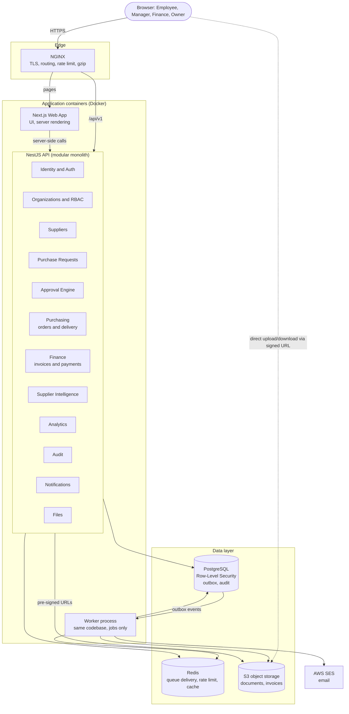
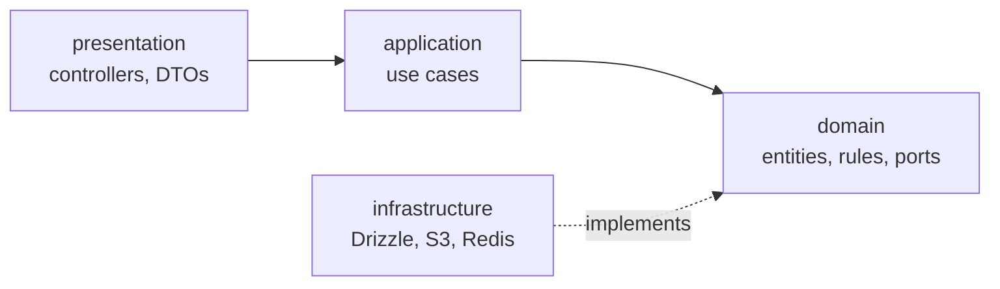
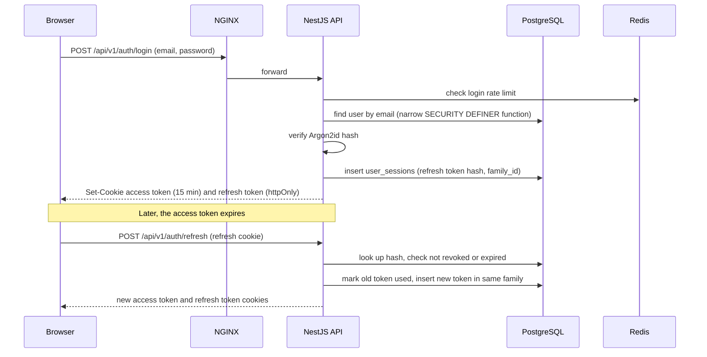
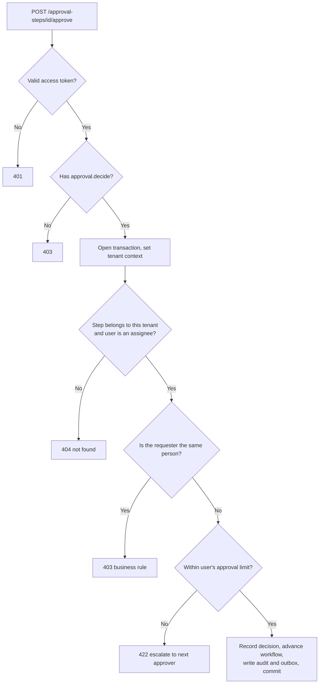
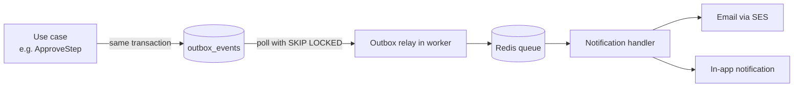
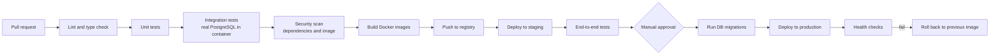

# 04. Application Architecture

## 4.1 Summary

SupplyMesh is a **modular monolith**. One NestJS backend, split into strict business modules, talks to one PostgreSQL database. A Next.js frontend serves the user interface. A separate worker process, built from the same code, runs background jobs. Redis is used in three narrow ways (queue delivery, rate limiting, short-lived cache). Files live in S3-compatible object storage. Everything runs in Docker containers behind NGINX.

| Concern | Choice |
|---|---|
| Architecture style | Modular monolith |
| Frontend | Next.js (App Router), TypeScript |
| Backend | NestJS on Node.js, TypeScript |
| Database | PostgreSQL with Drizzle ORM |
| Cache, queue delivery, rate limits | Redis |
| File storage | S3 (or S3-compatible storage) |
| Email | AWS SES |
| Reverse proxy | NGINX |
| Packaging and delivery | Docker, GitHub Actions |
| Hosting | AWS for production, a VPS for development and staging |

## 4.2 Choosing the Architecture Style

### 4.2.1 What the product demands

These requirements decide the style more than any trend.

| Product demand | Meaning for architecture |
|---|---|
| **Strong consistency in money flows.** Approving a request, creating the order, writing the audit log, and recording the event must succeed or fail together. | Operations that cross modules must be able to share one database transaction. |
| **Strict tenant isolation.** | One consistent place to apply tenant rules (token, repository, Row-Level Security). |
| **Many modules that depend on each other in a chain.** Request, approval, order, invoice, payment. | Modules need clear boundaries but frequent, reliable communication. |
| **Small team, short time to first release.** | Low operational cost. Few moving parts. |
| **Traffic is steady and business-hours-driven, not viral.** Procurement is a human workflow, not millions of requests per second. | No need to scale each module independently on day one. |
| **Auditability.** | One place where all changes are recorded in order. |

### 4.2.2 Options compared

| Criterion | Modular Monolith | Microservices | Service-Oriented Architecture (SOA) |
|---|---|---|---|
| Cross-module transaction (approve, create order, audit) | One database transaction | Needs sagas or distributed transactions. Failures leave half-done states that must be repaired. | Same problem as microservices |
| Tenant isolation enforcement | One place | Repeated in every service | Repeated in every service |
| Operational cost | One deployable, one database | Many deployables, many pipelines, service discovery, distributed tracing | Heavy shared middleware (service bus) |
| Speed of development for a small team | Fast | Slow. Contracts and infrastructure come first. | Slow |
| Debugging | One log, one stack trace | Requests span services | Requests span services |
| Independent scaling of one module | Not possible (scale the whole app) | Yes | Partly |
| Independent deployment of one module | No | Yes | Partly |
| Risk of wrong boundaries | Low. Moving a boundary is a code refactor. | High. Moving a boundary means changing contracts and data ownership. | High |
| Fit for this product today | **Strong** | Weak | Weak |

### 4.2.3 Decision

**Modular monolith.**

The deciding factor is the money flow. When a Procurement Manager issues a purchase order, the system must change the order, change the request status, write the audit log, and save an outbox event, **all or nothing**. In a modular monolith that is one transaction. In microservices it becomes a distributed process with compensation logic, and a bug in that logic means a request marked "converted" without an order, or an order without an audit record. For a financial system, that failure mode is worse than the scaling limit we accept.

### 4.2.4 Why microservices and SOA were rejected

- **Microservices** solve problems SupplyMesh does not have yet: teams that cannot work in one codebase, and modules that need to scale at very different rates. They add problems it does have: consistency across modules and a small team that would spend its time on infrastructure.
- **SOA** brings a central service bus and heavy contracts between large services. That is more ceremony than a single product team needs, and it has the same distributed-transaction cost.

### 4.2.5 What we give up, and how we reduce the risk

| We give up | How we limit the damage |
|---|---|
| Scale one module alone | The API is stateless and can run as several copies. Heavy work (reports, notifications) runs in the separate worker. |
| Deploy one module alone | Automated tests and fast pipelines make a full deploy low-risk. |
| Hard boundaries | Boundaries are enforced by tooling (see 4.4.3), not by good intentions. |
| Technology freedom per module | Accepted. One language and one framework are a benefit for a small team. |

### 4.2.6 The path to microservices, if ever needed

Modules communicate only through public interfaces and domain events, and each module owns its tables. So a module can later be moved out into its own service with limited work. The first candidates would be notifications, document processing, and analytics, because they are already asynchronous. The core money flow stays together.

## 4.3 High-Level Architecture Diagram



**How to read it.**
- The browser only talks to NGINX. NGINX sends pages to Next.js and API calls to NestJS.
- All business modules live inside **one** API process and share **one** database. They are separate boxes in the code, not separate services.
- The worker is the same code with a different start command. It reads the outbox events from PostgreSQL and does the slow work: email, expiry checks, report refresh.
- PostgreSQL is the **source of truth**. Redis and the queue only speed things up. If Redis is lost, the system becomes slower but loses no business data.
- Files never pass through the API. The browser uploads and downloads directly using short-lived signed links.

## 4.4 Backend Architecture

### 4.4.1 Modules

Each business area is a NestJS module with its own code and its own tables.

| Module | Owns (tables) | Responsibility |
|---|---|---|
| identity | users, user_sessions, invitations | Login, tokens, invitations, password reset |
| organizations | organizations, departments, document_sequences | Tenant setup, departments, settings |
| rbac | roles, permissions, role_permissions, user_roles | Roles, permissions, permission checks |
| suppliers | supplier_categories, suppliers, supplier_documents, supplier_verifications | Supplier lifecycle and verification |
| requests | purchase_requests, purchase_request_items | Request creation and status |
| approvals | approval_workflows, approval_workflow_steps, approval_instances, approval_instance_steps, approval_step_assignees, approval_decisions | Workflow matching, step progress, decisions |
| purchasing | purchase_orders, purchase_order_items, goods_receipts, goods_receipt_items | Orders and delivery tracking |
| finance | invoices, invoice_items, invoice_discrepancies, payments | Invoice matching, discrepancies, payments |
| intelligence | supplier_performance_events | Supplier events and, later, scoring |
| analytics | (read only, summary tables later) | Spending and approval-time reports |
| audit | audit_logs | Append-only change history |
| messaging | outbox_events | Outbox, event dispatch |
| notifications | (Release 2) | Email and in-app notifications |
| files | (no tables, uses S3) | Signed URLs, upload rules |

### 4.4.2 Layers inside each module (Clean Architecture)

Every module has the same four layers. Dependencies point **inward only**: outer layers know about inner layers, never the other way.

```
src/modules/approvals/
  presentation/      Controllers, request/response DTOs, guards.  (HTTP only)
  application/       Use cases: SubmitForApproval, ApproveStep, RejectStep.  (orchestration)
  domain/            Entities, value objects, policies, repository INTERFACES.  (pure business rules)
  infrastructure/    Drizzle repositories, S3 adapter, mappers.  (implements the interfaces)
```



**Why this matters for SupplyMesh.** The approval rules, the invoice matching logic, and the status machines are the valuable part of the product. They sit in the domain layer with no dependency on NestJS, Drizzle, or HTTP. So they can be tested in milliseconds without a database, and replacing a library never touches them.

### 4.4.3 Module boundary rules

1. A module may use another module only through its **public API** (an exported service interface) or by listening to its **domain events**.
2. A module never imports another module's repositories, entities, or tables.
3. A module never writes to another module's tables.
4. Read-only reporting queries may join across tables, but live only in the `analytics` module.
5. These rules are **checked automatically** in the build (an import-boundary lint rule, such as `dependency-cruiser` or `eslint-plugin-boundaries`). A pull request that breaks a rule fails.

### 4.4.4 Object-oriented design and SOLID in practice

| Principle | Where it appears in SupplyMesh |
|---|---|
| **Encapsulation, rich domain objects** | `PurchaseRequest` is a class with methods like `submit()`, `cancel()`, `markApproved()`. It protects its own state machine, so a request cannot go from `draft` to `converted` by accident. `Invoice.match(order, receipts)` holds the matching logic. |
| **Value objects** | `Money` (amount and currency, uses a decimal library, never JavaScript floats), `Quantity`, `DateRange`. They make invalid values impossible. Adding two `Money` values of different currencies throws an error. |
| **Single Responsibility** | One use case per action: `ApproveStepUseCase`, `CreatePurchaseOrderUseCase`. Controllers only translate HTTP. Repositories only store data. |
| **Open/Closed** | Approver types are strategies: `RoleApproverResolver`, `UserApproverResolver`, `DepartmentManagerResolver`. Adding "approver by cost center" means adding one class, not editing the approval engine. Invoice matching rules (price, quantity, total) are also separate rule classes behind one interface. |
| **Liskov Substitution** | Any `FileStorage` implementation (S3, MinIO, in-memory for tests) works wherever the interface is used, with the same behavior. |
| **Interface Segregation** | Small ports such as `SupplierReader` (read) and `SupplierWriter` (write). A module that only needs to check "is this supplier active?" depends on a one-method interface, not the whole supplier module. |
| **Dependency Inversion** | The domain defines `PurchaseOrderRepository` as an interface. Infrastructure provides the Drizzle implementation. NestJS dependency injection wires them. Tests inject fakes. |

### 4.4.5 Transactions and tenant context

- A **unit of work** wrapper opens one database transaction per use case. All repositories used inside it share that transaction.
- Before any query, the wrapper runs `SET LOCAL app.current_org_id = ...` (see document 03, section 3.11). The tenant ID comes from the request context, held in Node's `AsyncLocalStorage`, so it does not need to be passed through every function.
- The audit log row and the outbox event are written **inside the same transaction** as the business change. If the change fails, neither is saved.
- Domain events are collected on entities and written to `outbox_events` at commit.

### 4.4.6 Cross-cutting concerns

| Concern | Approach |
|---|---|
| Validation | Request DTOs validated at the edge (`class-validator` or Zod). Business validation in the domain. |
| Error handling | One global exception filter. Domain errors map to standard HTTP errors with a stable error code. |
| Logging | Structured JSON logs with `request_id`, `organization_id`, `user_id`. No passwords, tokens, or full card or bank numbers. |
| Configuration | Environment variables, validated at startup. The app refuses to start if one is missing. |
| Idempotency | Mutating endpoints that create money-related records accept an `Idempotency-Key` header, so a retried request does not create a second payment. |
| Concurrency | Optimistic locking with the `version` column on edited records. Pessimistic row locks (`FOR UPDATE`) on short money operations such as recording a payment. |

## 4.5 Frontend Architecture

| Topic | Decision |
|---|---|
| Framework | Next.js (App Router) with TypeScript |
| Rendering | **Server components** for data-heavy pages (lists, dashboards) to keep the browser light. **Client components** only for forms and interactive widgets. |
| Data from the API | A typed API client generated from the backend's OpenAPI document, so frontend and backend cannot drift apart. TanStack Query on the client for caching and refetching. |
| Forms | React Hook Form with Zod. The same rules as the backend DTOs where possible. |
| Styling and components | Tailwind CSS with an accessible component library (shadcn/ui, built on Radix). Consistent, keyboard-friendly, quick to build. |
| State | Server state in TanStack Query. Small local state in components. **No global state library** at the start, because almost all state is server data. |
| Authentication | Tokens are stored in `httpOnly`, `Secure`, `SameSite` cookies, so browser JavaScript cannot read them. Next.js middleware redirects unauthenticated users. |
| Permission-aware UI | The UI hides buttons the user cannot use. This is **only a convenience**. The backend checks every action. |
| Folder structure | By feature, not by type: `features/purchase-requests`, `features/approvals`, `features/suppliers`, each with its own components, hooks, and API calls. |
| Error and loading | Standard error boundaries, skeleton loaders, and clear messages for validation errors returned by the API. |
| Accessibility | Semantic HTML, keyboard navigation, and color contrast from the component library. |

**Why Next.js and not a plain React single-page app.** Next.js gives routing, server rendering, and middleware in one place, and the team already knows it. Server components reduce the amount of JavaScript sent to the browser, which matters for list-heavy pages.

**Why the frontend does not talk to the database.** Next.js is the presentation layer only. All rules, permissions, and tenant checks live in one place, the NestJS API. Splitting business logic between Next.js server code and NestJS would create two places to secure.

## 4.6 API Structure (overview)

The full endpoint list is in document 06. The principles are:

- REST over HTTPS, JSON bodies, versioned under `/api/v1`.
- Resource names in plural: `/suppliers`, `/purchase-requests`, `/purchase-orders`, `/invoices`.
- State changes as explicit actions, not as free edits of a status field: `POST /purchase-requests/{id}/submit`, `POST /approval-steps/{id}/approve`. This keeps business rules in one place.
- Keyset pagination with a cursor, filters by query string, and a standard error format.
- OpenAPI document generated from the code, used to build the typed frontend client and the documentation.
- Rate limiting at NGINX and per user in the API.
- The tenant is **never** part of the URL or body. It comes from the token.

## 4.7 Authentication Architecture

### 4.7.1 Design

| Topic | Decision |
|---|---|
| Method | Email and password. Passwords hashed with **Argon2id**. |
| Access token | Short-lived (about 15 minutes) signed JWT. Claims: user ID, organization ID, session ID, permission version. |
| Refresh token | Random opaque string, stored **hashed** in `user_sessions`, valid for several days, **rotated** on every use. |
| Reuse detection | Every refresh token belongs to a `family_id`. If an old token from a family is used again, the whole family is revoked. This detects stolen tokens. |
| Where tokens live | `httpOnly`, `Secure`, `SameSite=Lax` cookies. Not in `localStorage`. |
| CSRF | `SameSite` cookies plus a CSRF token on state-changing requests. |
| Login protection | Rate limit by IP and by account (counted in Redis). Temporary lock after repeated failures. Generic error messages that do not reveal whether an email exists. |
| Invitations | The Owner invites by email. A single-use token (stored hashed, with an expiry) lets the invitee set a password. |
| Password reset | Single-use hashed token with a short expiry. All sessions are revoked after a reset. |
| Multi-factor authentication | Planned for Owner and Finance roles (TOTP) in Release 2. The login flow has a place for a second step. |
| Logout and revocation | Logout revokes the session row. An admin or user can revoke all sessions. A disabled user cannot refresh. |

### 4.7.2 Login and refresh flow



### 4.7.3 Why JWT access tokens and database-backed refresh tokens

- A short-lived JWT means most requests are authorized **without a database call**.
- Because the access token is short, a stolen one is useful for minutes, not days.
- The refresh token is stored in PostgreSQL, so it can be **revoked** (logout, password reset, disabled user, stolen token). A pure stateless design cannot do that.
- Sessions are in PostgreSQL, not Redis, so a Redis outage never blocks sign-in.

## 4.8 Authorization Architecture

Authentication answers "who are you?". Authorization answers "what may you do, and to which records?". SupplyMesh checks four things, in this order, and **denies by default**.

| # | Check | Question | Where |
|---|---|---|---|
| 1 | **Permission** (RBAC) | Does one of the user's roles grant this action, for example `purchase_request.create`? | NestJS guard on the endpoint |
| 2 | **Scope** | Is the record inside what the permission allows: own record, own department, or whole organization? | Policy object in the use case |
| 3 | **Business rule** | Is this action allowed in the record's current state, for this person? Examples: not the requester, within approval limit, request is in the right step. | Domain layer |
| 4 | **Data boundary** | Is the row inside the user's organization? | Row-Level Security in the database |

### 4.8.1 Permissions and scope

Scope is part of the permission code, so it is stored as ordinary data in `permissions` and `role_permissions`. No special code is needed to give an organization a different setup.

| Example permission codes | Meaning |
|---|---|
| `purchase_request.create` | May create requests |
| `purchase_request.read_own` / `read_department` / `read_all` | See only own, own department, or every request |
| `approval.decide` | May act on approval steps assigned to them |
| `supplier.manage`, `supplier.verify` | Edit suppliers, verify suppliers |
| `purchase_order.create` | Create orders |
| `invoice.record`, `payment.record` | Finance actions |
| `audit.read` | See the audit log |
| `role.manage` | Configure roles (Owner) |

The default roles from the brief are **seeded** for each new organization as system roles. The Owner can create more roles by choosing permissions. This is how "configure roles and permissions" is met without changing code.

### 4.8.2 Permission loading and caching

- The access token carries a **permission version**, not the permission list. Lists would go stale and make the token large.
- On a request, the API loads the user's permission set from Redis (key `org:{id}:user:{id}:perms:{version}`). On a cache miss it reads PostgreSQL and fills the cache for a few minutes.
- When the Owner changes a role or a user's roles, the organization's permission version increases. The next request builds a fresh set. Access removal is effective immediately (BR-X3), not after the token expires.
- If Redis is down, the API reads from PostgreSQL directly. Slower, still correct.

### 4.8.3 Where each rule is enforced

| Rule | Layer |
|---|---|
| Only Finance can record payments | Permission (check 1) |
| An employee sees only their own requests | Scope (check 2) |
| A Department Manager sees only their department | Scope (check 2) |
| A manager approves only up to their limit | Business rule (check 3) |
| Requester cannot approve own request | Business rule (check 3), database trigger as backup |
| Organization A cannot read organization B | Data boundary (check 4), plus tenant ID taken from the token |

### 4.8.4 Example: approving a step



Note that a record from another tenant returns **404, not 403**. A 403 would confirm that the record exists.

## 4.9 Database Communication

| Topic | Decision |
|---|---|
| ORM | **Drizzle ORM**. Schema written in TypeScript, queries are typed, and the SQL stays visible. |
| Driver and pool | `node-postgres` pool in each process. **PgBouncer** in transaction-pooling mode in front of PostgreSQL when the number of connections grows. |
| Repositories | The domain defines repository interfaces. Infrastructure implements them with Drizzle. Use cases never call Drizzle directly. |
| Transactions | One transaction per use case through the unit-of-work wrapper. Tenant context is set at the start of every transaction. |
| Read side | Reporting and list screens use dedicated **query services** with plain Drizzle queries or SQL. They return shaped read models, not entities. This keeps reads fast and keeps domain objects simple. |
| Migrations | `drizzle-kit` generates migrations. Row-Level Security, triggers, and partitions are written as hand-written SQL migrations in the same folder. Migrations are versioned, reviewed, and run by the pipeline before the new app version starts. |
| Migration safety | Changes are made in compatible steps (add column, deploy code, backfill, then remove old column) so the previous app version keeps working during a deploy. |
| Money | Handled with a decimal library in code and `numeric` in the database. Never `number`. |
| IDs | UUID v7 generated in the application. |
| Roles | Three database roles: **owner** (runs migrations), **app** (no `BYPASSRLS`, used by API and worker), **readonly** (analytics and replica access). |

## 4.10 File and Document Storage

| Topic | Decision |
|---|---|
| Storage | A **private** S3 bucket, never public. Behind a `FileStorage` interface, so MinIO can replace S3 on a VPS and an in-memory fake in tests. |
| Upload flow | The browser asks the API for an upload link. The API checks permission, file type, and size, then returns a **pre-signed URL**. The browser uploads straight to S3. The file does not pass through the API. |
| Download flow | The API checks permission and returns a short-lived signed link. |
| Key structure | `org/{organization_id}/suppliers/{supplier_id}/{uuid}`. The tenant is part of the key, and the key is the only thing stored in the database (`file_key`). |
| Validation | Allowed types (PDF, PNG, JPG), maximum size, and a SHA-256 checksum stored with the record. File type is checked by content, not only by name. |
| Malware scan | A worker job scans new files (for example with ClamAV) before the document is marked usable. Added with supplier documents in Release 2. |
| Protection | Server-side encryption, bucket versioning, a lifecycle rule for old versions, and no public access. |
| Why not store files in PostgreSQL | It makes the database and backups large and slow, and puts file traffic on the same resource as financial transactions. Object storage is cheaper and built for it. |

## 4.11 Notification System

Release 2 feature, but the foundation is built in the MVP.



- **Domain events** such as `PurchaseRequestSubmitted`, `StepApproved`, `RequestRejected`, `InvoiceDiscrepancyFound` are written to the outbox in the same transaction as the change. Nothing is announced if the change fails, and nothing is lost if the server crashes after saving.
- A **relay** in the worker reads pending events (`FOR UPDATE SKIP LOCKED`, so several workers do not collide) and puts jobs in the queue.
- **Handlers** decide who to notify, build the message from a template, and send it.
- Handlers are **idempotent**. The event ID is checked, so a retry never sends a duplicate email.
- Failed sends are retried with growing delays, then moved to a failed list for review.
- Users can later choose which events they want by email or in-app (Release 2).

## 4.12 Background Processing

| Topic | Decision |
|---|---|
| Queue library | **BullMQ** on Redis |
| Process model | A separate **worker container** from the same codebase and image, started with a different command. A slow job never slows down API requests. |
| Source of truth | PostgreSQL. The outbox rows exist even if Redis loses its data, and the relay recreates the queue jobs. |
| Tenant context | Every job carries `organization_id` and sets the tenant context before it touches data. |
| Reliability | Retries with backoff, a maximum attempt count, and a failed-job list. Handlers are safe to run twice. |
| Scheduling | Repeatable jobs for nightly work. |

| Job | When | Purpose |
|---|---|---|
| Outbox relay | Every few seconds | Move events to the queue |
| Notification sender | On event | Email and in-app messages |
| Document expiry check | Nightly | Suspend suppliers with expired required documents (BR-S4) and write a supplier event |
| Data reconciliation | Nightly | Compare stored totals with the sum of lines, and `paid_amount` with payments. Alert on any difference. |
| Analytics refresh | Hourly or nightly | Rebuild summary tables (Release 3) |
| Partition maintenance | Monthly | Create next month's audit partitions, detach old ones |
| Outbox cleanup | Daily | Remove processed events older than a short window |
| Approval reminders and escalation | Hourly (Release 3) | Remind or escalate stalled approvals |

## 4.13 Caching Strategy

**Rule: cache for speed, never for truth.** PostgreSQL is always right. Redis can be flushed at any time without losing data.

| Data | Cached? | TTL and invalidation |
|---|---|---|
| User permission sets | Yes | A few minutes. Invalidated by permission version change. |
| Organization settings (tolerances, currency) | Yes | Invalidated when settings change. |
| Approval workflow rules | Yes | Invalidated when a workflow changes. |
| Dashboard aggregates | Yes | About 60 seconds. A little staleness is acceptable. |
| Supplier and category lookups for dropdowns | Yes | Short TTL, invalidated on change. |
| **Request, approval, order, invoice, payment state** | **No** | Consistency matters more than speed. |
| Per-user private pages | No shared caching | Avoids showing one user's data to another. |

Details:
- **Cache-aside** pattern: look in Redis, else read PostgreSQL and fill.
- Every key starts with the tenant: `org:{id}:...`. This prevents cross-tenant cache mixing.
- Protection against many requests rebuilding the same expired value at once (a short lock or request coalescing).
- Static assets use long-lived browser cache headers through NGINX, and a CDN (CloudFront) can be added later.
- If Redis is unavailable, the code falls back to the database.

### Is Redis required?

For the **MVP, Redis is useful but not critical.** The system remains correct without it.

| Use | Could PostgreSQL replace it? | Decision |
|---|---|---|
| Queue delivery (BullMQ) | Yes, with an outbox polling worker | Redis chosen: mature retries, delayed jobs, and scheduling. |
| Login and API rate limits | Partly, but with extra write load | Redis chosen: counters are its natural use. |
| Permission and settings cache | Yes, with a slower read | Redis chosen: removes a repeated query from nearly every request. |
| Sessions | Yes | **PostgreSQL chosen**, so sign-in never depends on Redis. |
| Business truth | n/a | Always PostgreSQL. |

The full reasoning is in the ADR document.

## 4.14 Technology Use: Needed Now vs Not Needed Now

The brief lists many technologies and asks which are needed and which are unnecessary at the start.

| Technology | Verdict | Reason |
|---|---|---|
| TypeScript | Use | One language across frontend and backend. Types prevent a large class of bugs, especially around money and status values. |
| Next.js | Use | UI, routing, server rendering. |
| Node.js | Use | Runtime for both applications. |
| NestJS | Use | Modules, dependency injection, and guards map directly to the modular monolith and layered design. |
| Express.js | Not used directly | NestJS runs on Express internally. Writing a second layer on top would add nothing. |
| PostgreSQL | Use | See document 03. |
| Drizzle ORM | Use | See ADR. |
| Redis | Use, narrowly | Queue delivery, rate limits, cache. Not the source of truth. |
| Docker, multi-container | Use | Identical environments. Containers: nginx, web, api, worker, redis, postgres (local). |
| NGINX | Use | TLS termination, routing, rate limiting, compression, static files. |
| GitHub Actions, CI/CD | Use | Automated tests and repeatable deployments. |
| AWS | Use, selectively | S3 (files), SES (email), RDS for PostgreSQL in production, EC2 or ECS for containers. |
| VPS | Use for dev and staging | Cheap and simple environments with Docker Compose. |
| Kubernetes | **Not needed** | Operational burden is far above what one API and one worker need. Docker Compose, then ECS if scale demands. |
| Microservices, service mesh | **Not needed** | See 4.2. |
| Kafka or RabbitMQ | **Not needed** | The outbox plus BullMQ covers our event volume. |
| Elasticsearch | **Not needed** | PostgreSQL trigram and full-text search are enough for supplier and request search. |
| GraphQL | **Not needed** | Screens are well known, and REST with a typed client is simpler to secure and cache. |
| Event sourcing | **Not needed** | The audit log and immutable payments give the needed history. |
| Separate analytics warehouse | **Not needed now** | Read replica and summary tables first. |

## 4.15 Deployment Architecture

### 4.15.1 Environments

| Environment | Where | Purpose |
|---|---|---|
| Local | Docker Compose on the developer machine | Development |
| Staging | VPS with Docker Compose | Integration testing, demos, preview of releases |
| Production | AWS: containers on EC2 (ECS later), RDS PostgreSQL, S3, SES, Redis (ElastiCache or a container) | Customers |

### 4.15.2 CI/CD pipeline



- Images are tagged with the commit ID, so rollback means deploying the previous tag.
- Migrations run **before** the new version starts and are written to be backward compatible.
- Secrets live in GitHub secrets and AWS Secrets Manager, never in the repository.
- Production database: automated backups with point-in-time recovery, and regular restore drills. A backup that has never been restored is not a backup.
- The API exposes `/health` (process alive) and `/ready` (database reachable) for NGINX and the orchestrator.

## 4.16 Testing Strategy

| Level | What | Tools | Examples |
|---|---|---|---|
| **Unit** (many, fast) | Domain logic with no database | Jest or Vitest | Request state machine. Workflow matching by amount. Invoice matching with tolerance. `Money` arithmetic. |
| **Integration** | Repositories and use cases against a real PostgreSQL | Testcontainers | Composite foreign keys reject cross-tenant links. Constraints work. Transactions roll back correctly. |
| **Tenant isolation** | Security-critical | Integration suite | Organization A calling every endpoint with organization B's IDs gets 404. Raw queries under A's context see no B rows. Every table with `organization_id` has an RLS policy. |
| **Concurrency** | Race conditions | Parallel integration tests | Two approvers deciding at once. Two payments racing on one invoice. Duplicate invoice submitted twice. |
| **API / contract** | Endpoints and OpenAPI | Supertest | Status codes, error format, permission failures (401, 403, 404). |
| **End-to-end** (few, slow) | Critical journeys through the UI | Playwright | The three journeys from document 02. |
| **Performance** | Key endpoints under load | k6 | Request list, approval inbox, dashboard. |
| **Security** | Known weaknesses | Dependency audit, image scan, OWASP checklist | Injection, access control, token handling. |

Principle: most effort goes where a mistake costs money: the **domain logic**, the **approval engine**, the **matching rules**, and **tenant isolation**.

## 4.17 Security Overview

| Threat | Defense |
|---|---|
| Cross-tenant data access | Token-based tenant, repository filter, composite foreign keys, Row-Level Security, isolation tests |
| Stolen credentials | Argon2id, rate limiting, lockout, optional MFA for sensitive roles |
| Stolen tokens | Short access tokens, rotating refresh tokens with reuse detection, `httpOnly` cookies |
| SQL injection | Parameterized queries through Drizzle. No string-built SQL. |
| Cross-site scripting | React escaping, strict Content-Security-Policy header, no unsafe HTML |
| Cross-site request forgery | `SameSite` cookies and CSRF tokens |
| Privilege escalation | Deny by default, server-side permission and scope checks, separation of duties |
| Fraud by insiders | Approval rules, no self-approval, immutable payments, full audit trail |
| Malicious file upload | Type and size checks, content inspection, malware scan, private bucket, signed URLs |
| Data exposure in logs | Structured logs that avoid secrets and sensitive fields |
| Vulnerable dependencies | Automated dependency and image scanning in the pipeline |
| Data loss | Backups with point-in-time recovery, S3 versioning, tested restores |
| Excess database privileges | Separate owner, app, and read-only roles. The app role cannot bypass RLS. |

## 4.18 Limitations and Evolution Path

| Limitation | Effect | Path forward |
|---|---|---|
| The whole backend deploys as one unit | A small change still redeploys everything | Fast pipelines, automated tests. Extract a module only if it truly needs separate scaling. |
| One database is a shared resource | One very heavy report can slow others | Read replica, summary tables, move heavy tenants to their own database. |
| Module boundaries rely on tooling | Discipline can slip | Lint rules fail the build. Architecture tests in CI. |
| Redis adds an operational piece | One more thing to run and monitor | The system keeps working without it, only slower. |
| Single region at first | A region outage means downtime | Backups and infrastructure as code allow recovery. Multi-region is a later business decision. |
| No supplier-facing portal | Suppliers cannot self-serve | Separate authentication context in a later release. |
