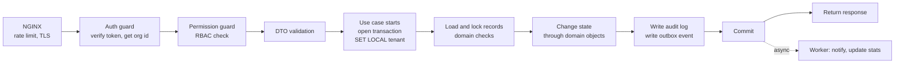
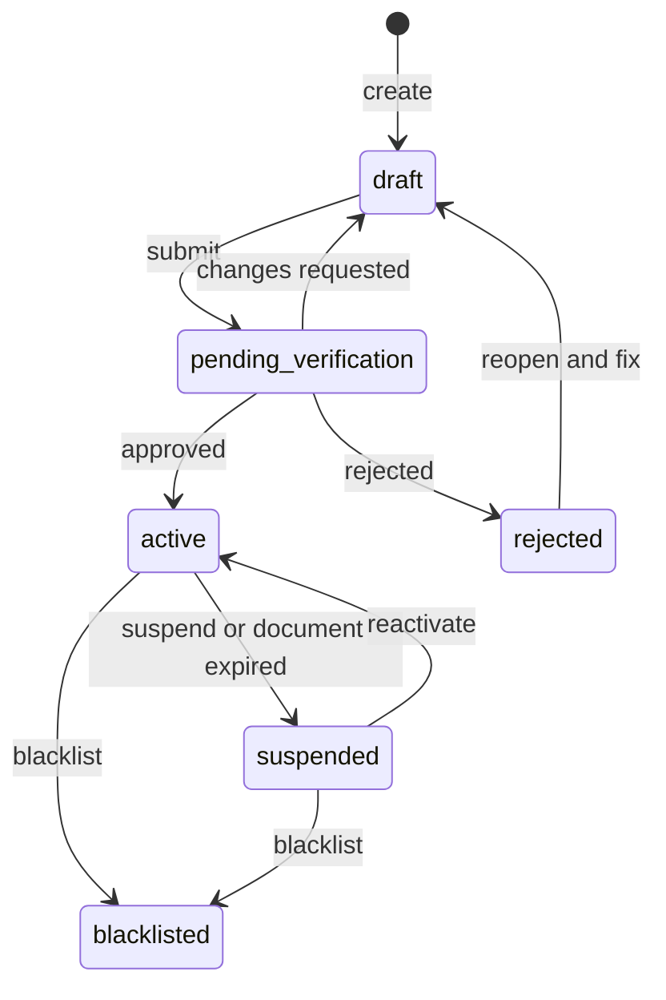
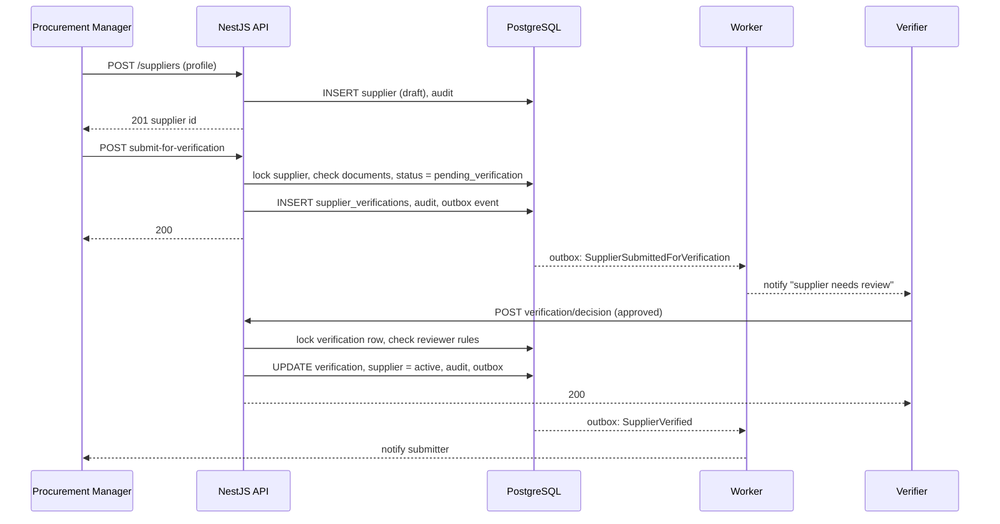
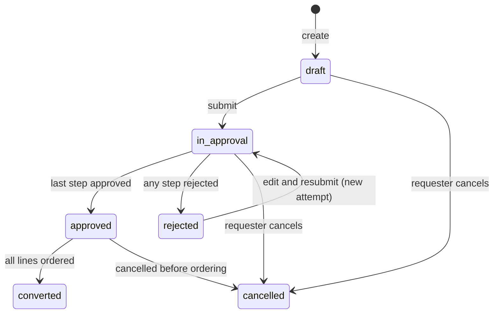
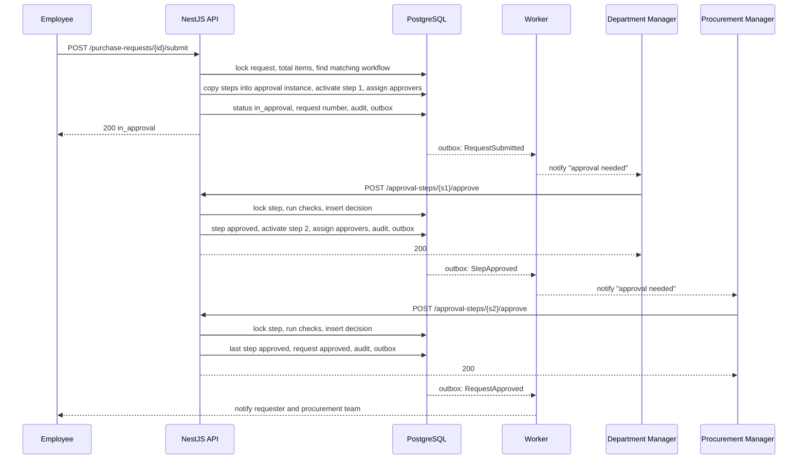
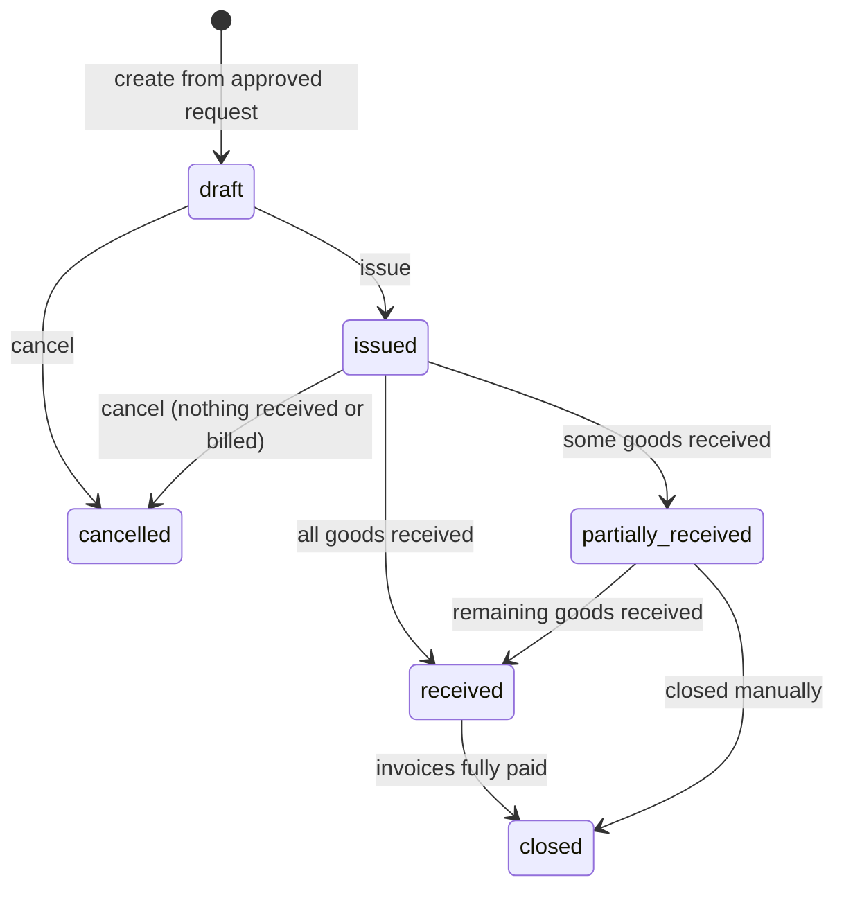
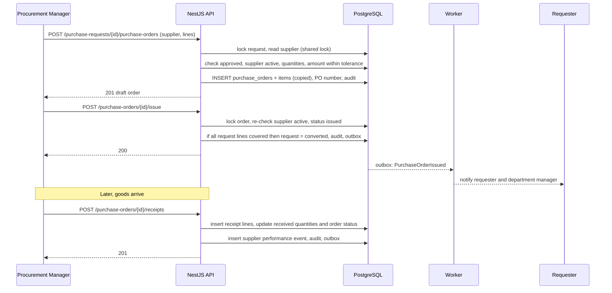
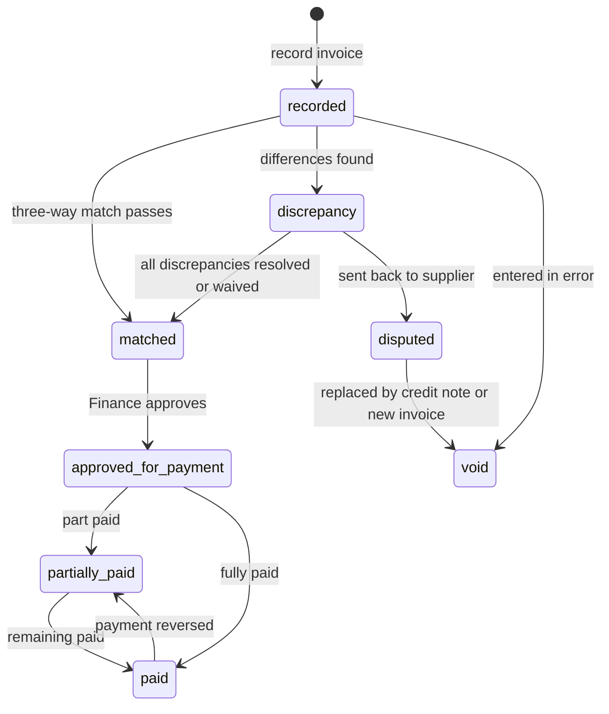
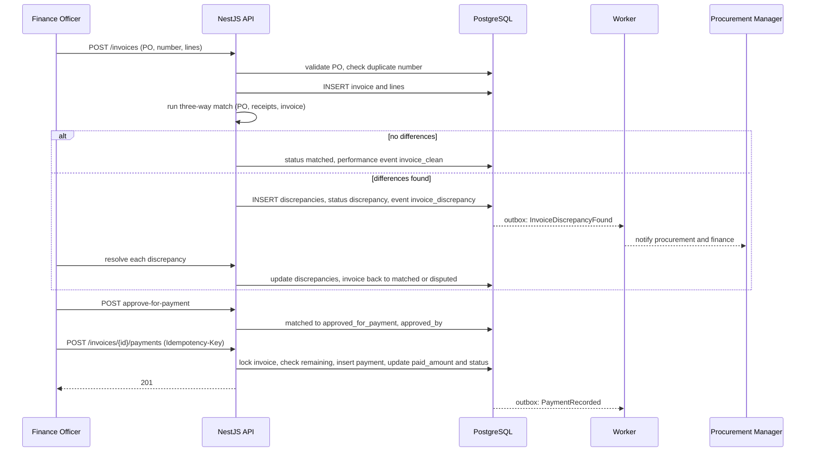

# 05. System Design

This document describes the four critical workflows in detail, then the bottlenecks, scaling plan, and fault tolerance of the whole system.

| # | Workflow | Section |
|---|---|---|
| 1 | Supplier registration and verification | 5.2 |
| 2 | Purchase request and multi-level approval | 5.3 |
| 3 | Purchase order generation | 5.4 |
| 4 | Invoice verification and payment processing | 5.5 |
| | Bottlenecks, scaling, and fault tolerance | 5.6 |

Each workflow answers the same eight questions: request flow, business logic, data flow, database operations, authorization checks, failure scenarios, transaction handling, and notification flow.

## 5.1 The Common Write Path

All four workflows are built on one standard pipeline for every command that changes data. Describing it once avoids repeating it in each workflow.



Rules that apply everywhere:

| Rule | Detail |
|---|---|
| **One transaction per command** | State change, audit log row, and outbox event commit together or not at all. |
| **Tenant from the token** | The organization ID is never read from the URL or body. |
| **Not found, not forbidden, across tenants** | A record in another organization returns `404`. |
| **Optimistic locking** | Edits send the record `version`. A stale version returns `409`. |
| **Row locks for money and approvals** | `SELECT ... FOR UPDATE` on the single row being decided, held briefly. |
| **Idempotency** | Payment and other money-creating endpoints require an `Idempotency-Key`. A retry returns the original result. |
| **Standard errors** | `400` invalid input, `401` not signed in, `403` not allowed, `404` not found, `409` conflict or wrong state, `422` business rule violated. Each carries a stable error code (for example `APPROVAL_LIMIT_EXCEEDED`). |
| **Side effects after commit** | Email and other slow work happen in the worker, never inside the request. |

---

## 5.2 Workflow 1: Supplier Registration and Verification

### 5.2.1 Purpose

Make sure only known, checked suppliers can receive purchase orders (rule BR-S2).

### 5.2.2 Status lifecycle



### 5.2.3 Request flow

| Step | Endpoint | Actor |
|---|---|---|
| 1 | `POST /api/v1/suppliers` create draft | Procurement Manager |
| 2 | `PATCH /api/v1/suppliers/{id}` edit profile (with `version`) | Procurement Manager |
| 3 | `POST /api/v1/suppliers/{id}/documents/upload-url` get signed link, browser uploads to S3, then `POST /suppliers/{id}/documents` register the file *(Release 2)* | Procurement Manager |
| 4 | `POST /api/v1/suppliers/{id}/submit-for-verification` | Procurement Manager |
| 5 | `POST /api/v1/suppliers/{id}/verification/decision` with `decision` and `comment` | Verifier |
| 6 | `POST /suppliers/{id}/suspend`, `/reactivate`, `/blacklist` | Procurement Manager |



### 5.2.4 Business logic

1. **Create.** Name must be unique in the organization (case-insensitive), enforced by the unique index (BR-S3). Tax ID or registration number matching an existing supplier produces a **warning** with a link, not a block, because legitimate branches may share a number.
2. **Submit.** Allowed only from `draft`. The profile must be complete. If the organization has set **required documents** for the supplier's category, each must be uploaded and not rejected. Moves to `pending_verification` and creates a `supplier_verifications` row.
3. **Locked while pending.** A supplier under review cannot be edited. This prevents changing details after the reviewer looked at them.
4. **Decision.** Three outcomes: `approved` (supplier becomes `active`, `verified_at` set), `rejected` (becomes `rejected`, comment required), `changes_requested` (returns to `draft`, comment required).
5. **Four-eyes rule.** By default the verifier must be a different person from the submitter. An organization with a single procurement person can switch this off in settings.
6. **Suspend and blacklist.** A supplier with an expired required document is suspended automatically by the nightly job (BR-S4). Blacklisting is refused while the supplier has open purchase orders (BR-S5).
7. **History.** Each submission creates a new verification row, so every review attempt is kept.

### 5.2.5 Data flow and database operations

| Command | Database operations (one transaction) |
|---|---|
| Create | `INSERT suppliers` (draft) → `INSERT audit_logs` |
| Edit | `UPDATE suppliers ... WHERE id = ? AND version = ?` (0 rows updated means stale version) → audit |
| Register document | `INSERT supplier_documents` → audit. The file is already in S3. |
| Submit | `SELECT suppliers FOR UPDATE` → check required documents → `UPDATE suppliers SET status = 'pending_verification'` → `INSERT supplier_verifications` → audit → `INSERT outbox_events` |
| Decision | `SELECT supplier_verifications ... WHERE decision IS NULL FOR UPDATE` → check reviewer ≠ submitter → `UPDATE supplier_verifications` → `UPDATE suppliers` (status, `verified_at`) → audit → outbox |
| Blacklist | `SELECT suppliers FOR UPDATE` → `SELECT count(*) FROM purchase_orders WHERE supplier_id = ? AND status IN ('draft','issued','partially_received')` → `UPDATE suppliers` → audit |

### 5.2.6 Authorization checks

| Action | Permission | Extra checks |
|---|---|---|
| Create, edit, submit, suspend, blacklist | `supplier.manage` | Tenant from token, row-level security |
| Decide on verification | `supplier.verify` | Reviewer ≠ submitter (if setting on). Verification row must still be pending. |
| Read suppliers | `supplier.read` | All roles except Employee |
| Upload and read documents | `supplier.manage` / `supplier.read` | Signed link issued only after permission check |

### 5.2.7 Failure scenarios

| Failure | What happens |
|---|---|
| Duplicate supplier name | `409 SUPPLIER_NAME_EXISTS`. Nothing saved. |
| Two people edit the same supplier | The second save gets `409` (stale version). The user reloads and retries. |
| Submit with a missing required document | `422 REQUIRED_DOCUMENT_MISSING` with the list of missing types. |
| Two verifiers decide at the same moment | The row lock serializes them. The second sees a completed review and gets `409 ALREADY_DECIDED`. |
| Reviewer is the submitter | `403 SEPARATION_OF_DUTIES`. |
| File upload to S3 fails or is abandoned | No document row is created, because registration happens after a successful upload. A file uploaded but never registered is deleted by an S3 lifecycle rule. |
| Malware detected in a document (Release 2) | The document is marked `rejected`. The supplier cannot be submitted until it is replaced. |
| Blacklist with open orders | `422 SUPPLIER_HAS_OPEN_ORDERS`. |
| Worker or email provider down | Business result is already saved. The outbox event waits and is retried. Nobody loses the supplier, they only get the notification later. |

### 5.2.8 Transaction handling

- Each command is **one short transaction**. File upload is deliberately **outside** the transaction, because holding a database transaction open during a network upload would waste connections and risk timeouts.
- The order "upload first, register after" means the database never points to a file that does not exist. The reverse (a file with no row) is harmless and cleaned up.
- Optimistic locking protects edits. A row lock protects the decision step.

### 5.2.9 Notification flow

| Event | Recipients | Message |
|---|---|---|
| `SupplierSubmittedForVerification` | Users with `supplier.verify` (except the submitter if four-eyes is on) | "Supplier X is waiting for review" |
| `SupplierVerified` | Submitter | "Supplier X is now active" |
| `SupplierRejected` / `SupplierChangesRequested` | Submitter | Includes the reviewer's comment |
| `SupplierDocumentExpiring` *(Release 2)* | Procurement Managers | 30 days before expiry |
| `SupplierSuspended` | Procurement Managers | Reason (expired document or manual) |

---

## 5.3 Workflow 2: Purchase Request and Multi-Level Approval

### 5.3.1 Purpose

Make sure nothing is bought without the right people agreeing, using the organization's own rules, with a complete record.

### 5.3.2 Status lifecycle



Note: `submitted` exists as a status for the instant between submit and the first step becoming active. In the normal flow both happen in one transaction, so users see `in_approval`.

### 5.3.3 Example rules (defaults, all configurable)

| Workflow | Amount range | Steps |
|---|---|---|
| W1 | $0 up to $500 | 1. Department Manager |
| W2 | $500 up to $5,000 | 1. Procurement Manager |
| W3 | $5,000 and above | 1. Department Manager → 2. Procurement Manager → 3. Organization Owner |

Each range includes its lower bound and excludes its upper bound, so $500 is handled by W2, and $5,000 by W3. This removes any gap or overlap at the edges.

### 5.3.4 Request flow

| Step | Endpoint | Actor |
|---|---|---|
| 1 | `POST /api/v1/purchase-requests` create draft with items | Employee |
| 2 | `PATCH /api/v1/purchase-requests/{id}` edit draft (with `version`) | Employee |
| 3 | `POST /api/v1/purchase-requests/{id}/submit` | Employee |
| 4 | `GET /api/v1/approvals/inbox` list my pending steps | Approver |
| 5 | `POST /api/v1/approval-steps/{id}/approve` | Approver |
| 6 | `POST /api/v1/approval-steps/{id}/reject` with required `comment` | Approver |
| 7 | `POST /api/v1/purchase-requests/{id}/cancel` | Requester |



### 5.3.5 Business logic

**On submit:**
1. The request must be `draft` or `rejected`, belong to the caller, and have at least one item. Required delivery date must not be in the past (BR-R3).
2. Total is recalculated from the items on the server. The client's total is never trusted.
3. **Workflow matching.** The first active workflow, by `evaluation_order`, whose amount range contains the total and whose department is empty or equals the request's department.
4. If no workflow matches, the submit is **refused** (`422 NO_APPROVAL_RULE`) and the Owner is notified. The system never lets a request through without a rule.
5. **Snapshot.** The workflow's steps are copied into `approval_instances` and `approval_instance_steps` (BR-R6). Step 1 becomes `pending` and the rest `waiting`.
6. **Resolving approvers** for the active step:
   - `role`: all active users holding that role.
   - `user`: that one user.
   - `department_manager`: the manager of the request's department.
   Then three filters: remove the **requester** (BR-R7), remove users whose **approval limit** is below the request total (BR-R9), remove disabled users. The remaining users are written to `approval_step_assignees`.
7. If no approver remains, the system falls back to users with the Owner role. If still none, submit is refused (`422 NO_ELIGIBLE_APPROVER`).
8. The request number (for example `PR-2026-000123`) is assigned now, at the end of the transaction, to keep the sequence lock short.

**On approve:**
1. The step must be `pending`, and the caller must be an assignee.
2. The caller must not be the requester, and the limit must cover the total (checked again, because limits can change).
3. The decision is saved. If the number of approvals reaches `required_approvals`, the step is approved.
4. If another step follows, it is activated (with its own approver resolution). If it was the last step, the instance and the request become `approved`.

**On reject:**
1. A comment is mandatory (BR-R8).
2. The step, the instance, and the request become `rejected`. Remaining `waiting` steps become `skipped`. One rejection ends the attempt, even in a step that needs several approvals.
3. The requester may edit and submit again. This creates a **new instance** with `attempt_no + 1`. The workflow is matched again, so if the amount changed, the new rules apply.

**Other rules:**
- A request in approval cannot be edited. To change it, cancel and create again, or wait for rejection.
- Changing a workflow template never affects requests already in approval.

### 5.3.6 Data flow and database operations

**Submit (one transaction):**

```
BEGIN;  SET LOCAL app.current_org_id = :org;
 1. SELECT * FROM purchase_requests WHERE id = :id FOR UPDATE;          -- check status, owner, version
 2. SELECT sum(quantity * unit_estimated_cost) FROM purchase_request_items WHERE purchase_request_id = :id;
 3. UPDATE purchase_requests SET total_estimated_cost = :total ...;
 4. SELECT * FROM approval_workflows WHERE is_active AND min_amount <= :total
       AND (max_amount IS NULL OR :total < max_amount)
       AND (department_id IS NULL OR department_id = :dept)
    ORDER BY evaluation_order LIMIT 1;
 5. SELECT * FROM approval_workflow_steps WHERE workflow_id = :wf ORDER BY step_order;
 6. INSERT INTO approval_instances (... attempt_no = previous + 1 ...);   -- partial unique index blocks a second active instance
 7. INSERT INTO approval_instance_steps (...) one row per template step;
 8. UPDATE approval_instance_steps SET status = 'pending', activated_at = now() WHERE step_order = 1;
 9. INSERT INTO approval_step_assignees (...) for each eligible approver;
10. UPDATE document_sequences SET last_value = last_value + 1 ... RETURNING last_value;   -- only if no number yet
11. UPDATE purchase_requests SET status = 'in_approval', request_number = ..., submitted_at = now(), version = version + 1;
12. INSERT INTO audit_logs (...);  INSERT INTO outbox_events (...);
COMMIT;
```

**Approve (one transaction):**

```
BEGIN;  SET LOCAL app.current_org_id = :org;
 1. SELECT s.*, i.purchase_request_id, r.requester_id, r.total_estimated_cost
      FROM approval_instance_steps s JOIN approval_instances i ... JOIN purchase_requests r ...
     WHERE s.id = :step FOR UPDATE OF s;                   -- serializes everyone deciding on this step
 2. Check: s.status = 'pending'; caller in approval_step_assignees; caller <> requester; limit covers total.
 3. INSERT INTO approval_decisions (...);                  -- unique (step_id, approver_id) + trigger as backup
 4. SELECT count(*) FROM approval_decisions WHERE step_id = :step AND decision = 'approved';
 5. If count >= required_approvals:
      UPDATE approval_instance_steps SET status = 'approved', completed_at = now();
      If next step exists: set it 'pending', resolve and INSERT assignees;
      Else: UPDATE approval_instances SET status = 'approved'; UPDATE purchase_requests SET status = 'approved', approved_at = now();
 6. INSERT INTO audit_logs (...);  INSERT INTO outbox_events (...);
COMMIT;
```

**Inbox query** (index `ix_assignee_inbox`):
`SELECT ... FROM approval_step_assignees a JOIN approval_instance_steps s ON ... WHERE a.user_id = :me AND s.status = 'pending' ORDER BY s.activated_at`.

### 5.3.7 Authorization checks

| Action | Permission | Scope and rules |
|---|---|---|
| Create, edit, submit, cancel | `purchase_request.create` | Only the requester's own draft |
| View requests | `read_own` / `read_department` / `read_all` | Employee own, Department Manager department, Owner and Finance all |
| See the inbox | `approval.decide` | Only steps where the user is an assignee |
| Approve or reject | `approval.decide` | Assignee, not the requester, within limit, step pending |
| Configure workflows | `workflow.manage` | Owner only. Changes are audited. |

### 5.3.8 Failure scenarios

| Failure | What happens |
|---|---|
| No workflow matches the amount | `422 NO_APPROVAL_RULE`. Owner notified to configure a rule. |
| No eligible approver (for example the only department manager is also the requester) | Falls back to Owner. If none, `422 NO_ELIGIBLE_APPROVER`. |
| Two approvers on the same step click at once | Step row lock serializes them. With `required_approvals = 2` both are counted. With `1`, the second gets `409 STEP_ALREADY_COMPLETED`. |
| Same approver double-clicks | Unique `(step_id, approver_id)` returns the original result (`409` mapped to idempotent success on the same decision). |
| Approver acts after the request was cancelled | Step is no longer pending: `409 STEP_NOT_PENDING`. |
| Approver is disabled or loses their role while a step waits | A nightly job finds pending steps with no active assignee and notifies the Owner. The Owner reassigns (Release 3) or the request is cancelled and resubmitted. This is a known gap in the MVP and appears in the risk list. |
| Approver's limit lowered after assignment | The re-check at decision time returns `422 APPROVAL_LIMIT_EXCEEDED`. |
| Requester edits while submitting | Row lock plus version check. One of them gets `409`. |
| Workflow template changed mid-approval | No effect. The instance carries its own copy. |
| Server crashes after commit, before sending email | The outbox row is already saved. The worker sends the email after restart. |
| Server crashes before commit | Nothing is saved. The user retries. |

### 5.3.9 Transaction handling

- Submit and each decision are **single transactions**. Moving to the next step happens inside the same transaction as the decision, so there is never a request "approved but with the next step not activated."
- The lock is on **one step row**, so unrelated approvals never block each other.
- The request number comes last to keep the sequence lock short.
- The audit row and outbox row are in the transaction. They exist if and only if the change exists.

### 5.3.10 Notification flow

| Event | Recipients |
|---|---|
| `RequestSubmitted` | Approvers of step 1 ("approval needed") |
| `StepApproved` (not last) | Approvers of the next step; requester gets a progress update |
| `RequestApproved` | Requester and Procurement Managers ("ready for purchase order") |
| `RequestRejected` | Requester, with the rejection comment |
| `NoApprovalRule` / `NoEligibleApprover` | Owner |
| Reminders and escalation *(Release 3)* | Pending approvers, then their escalation target |

---

## 5.4 Workflow 3: Purchase Order Generation

### 5.4.1 Purpose

Turn an approved request into a binding order to one verified supplier, without letting the order drift away from what was approved.

### 5.4.2 Status lifecycle



### 5.4.3 Request flow

| Step | Endpoint | Actor |
|---|---|---|
| 1 | `GET /api/v1/purchase-requests?status=approved` list orderable requests | Procurement Manager |
| 2 | `POST /api/v1/purchase-requests/{id}/purchase-orders` create draft order | Procurement Manager |
| 3 | `PATCH /api/v1/purchase-orders/{id}` adjust prices, dates, notes while draft | Procurement Manager |
| 4 | `POST /api/v1/purchase-orders/{id}/issue` | Procurement Manager |
| 5 | `POST /api/v1/purchase-orders/{id}/receipts` record a delivery | Procurement Manager |
| 6 | `POST /api/v1/purchase-orders/{id}/cancel`, `/close` | Procurement Manager |



### 5.4.4 Business logic

**Create draft:**
1. The request must be `approved` (BR-P1). Not `draft`, `in_approval`, `rejected`, or `cancelled`.
2. The supplier must be `active` (BR-S2). The supplier's currency must equal the request's currency. Mixed currency is out of scope for the first release.
3. Each order line points to a request line. **Quantity** ordered across all non-cancelled orders for a request line cannot exceed the requested quantity.
4. **Amount check (BR-P2).** The sum of all non-cancelled order totals for this request cannot exceed the approved total plus the organization's tolerance (default 10%). Above that, the order is refused with `422 EXCEEDS_APPROVED_AMOUNT`. The procurement manager must ask for a new request or an amended one, which goes through approval again. This is what stops "approved for $400, ordered for $4,000."
5. **Snapshot (BR-P5).** Names, descriptions, quantities, and the agreed unit prices are copied into order lines. Later changes to the request or supplier do not change the order.
6. **Money.** Line totals and tax are calculated with a decimal library and rounded per line. Header totals are the sum of line totals. The database checks `total = subtotal + tax`.
7. The PO number (for example `PO-2026-000045`) is assigned at the end of the transaction.
8. The department of the request is carried onto the order for spending reports.

**Issue:**
1. The order must be `draft`, with at least one line.
2. The supplier is checked **again**, because it may have been suspended since the draft was created.
3. The order becomes `issued`, `issued_at` is set, and from now on prices and quantities are frozen. Changing an issued order means cancelling and recreating.
4. After issue, if every request line is fully covered by issued orders, the request becomes `converted`.
5. In the first release, sending the order to the supplier is manual (print or download, then email). Automatic sending is in a later release.

**Record delivery (goods receipt):**
1. The order must be `issued` or `partially_received`.
2. For each line, `quantity_received` cannot exceed the outstanding quantity (ordered minus already received). Over-delivery is refused. The user records the excess as a note or contacts the supplier.
3. `received_quantity` on each order line increases, using a guarded update (`... WHERE received_quantity + :q <= quantity`), so two simultaneous receipts cannot over-receive.
4. Order status becomes `partially_received` or `received`.
5. A **supplier performance event** is written: `delivery_on_time` or `delivery_late` (with days late) compared to `expected_delivery_date`, and `partial_delivery` when needed.

**Cancel:** allowed for `draft`, or `issued` with no receipts and no invoices (BR-P4). Otherwise the order can only be closed. Cancelling frees the quantity on the request, and writes an `order_cancelled` performance event.

**Close:** when the order is `received` and all its invoices are paid, a transaction at payment time (or the nightly job) moves it to `closed`, and writes `order_completed`.

### 5.4.5 Data flow and database operations

**Create draft:**

```
BEGIN;  SET LOCAL app.current_org_id = :org;
 1. SELECT * FROM purchase_requests WHERE id = :req FOR UPDATE;          -- serializes concurrent order creation for one request
 2. Check status = 'approved'.
 3. SELECT * FROM suppliers WHERE id = :sup FOR SHARE;                   -- blocks suspension while we create the order
 4. Check supplier status = 'active' and currency matches.
 5. SELECT request_item_id, sum(quantity) FROM purchase_order_items i JOIN purchase_orders o ...
     WHERE o.purchase_request_id = :req AND o.status <> 'cancelled' GROUP BY request_item_id;   -- already ordered
 6. Compute lines, subtotal, tax, total (decimal arithmetic).
 7. SELECT coalesce(sum(total_amount),0) FROM purchase_orders WHERE purchase_request_id = :req AND status <> 'cancelled';
    Check (existing + new) <= approved total * (1 + tolerance).
 8. INSERT INTO purchase_orders (...);  INSERT INTO purchase_order_items (...);
 9. UPDATE document_sequences ... RETURNING last_value;                  -- last, so the lock is short
10. INSERT INTO audit_logs (...);  INSERT INTO outbox_events (...);
COMMIT;
```

**Record delivery:**

```
BEGIN;  SET LOCAL app.current_org_id = :org;
 1. SELECT * FROM purchase_orders WHERE id = :po FOR UPDATE;
 2. INSERT INTO goods_receipts (...);
 3. For each line:
      INSERT INTO goods_receipt_items (...);
      UPDATE purchase_order_items SET received_quantity = received_quantity + :q
       WHERE id = :item AND received_quantity + :q <= quantity;           -- 0 rows updated = over-delivery, abort
 4. UPDATE purchase_orders SET status = CASE WHEN all lines complete THEN 'received' ELSE 'partially_received' END;
 5. INSERT INTO supplier_performance_events (...);
 6. INSERT INTO audit_logs (...);  INSERT INTO outbox_events (...);
COMMIT;
```

### 5.4.6 Authorization checks

| Action | Permission | Extra checks |
|---|---|---|
| Create, edit, issue, cancel, close | `purchase_order.create` / `purchase_order.manage` | Procurement Manager. Request must belong to the same tenant. |
| Record delivery | `goods_receipt.record` | Procurement Manager |
| View orders | `purchase_order.read` | Procurement, Finance, Owner see all. Department Manager sees department orders. Employee sees orders linked to their own requests. |
| Separation of duties | n/a | Finance has no permission to create or edit orders. |

### 5.4.7 Failure scenarios

| Failure | What happens |
|---|---|
| Request not approved | `409 REQUEST_NOT_APPROVED` |
| Supplier not active, or suspended between draft and issue | `422 SUPPLIER_NOT_ACTIVE` at create or issue |
| Currency mismatch | `422 CURRENCY_MISMATCH` |
| Order total beyond tolerance | `422 EXCEEDS_APPROVED_AMOUNT`. Message tells how much over. |
| Quantity beyond what is left on the request line | `422 QUANTITY_EXCEEDS_REQUEST` |
| Two procurement managers create orders for the same request at once | The request row lock serializes them. The second sees the first order's quantities and is checked against what remains. |
| Over-delivery | `422 OVER_RECEIPT`. Guarded update prevents it even under concurrency. |
| Cancel after goods or invoices exist | `422 ORDER_HAS_ACTIVITY` |
| Edit an issued order | `409 ORDER_FROZEN` |
| Stale version | `409` |
| Sequence row contention (many orders in one organization at once) | Short wait. Number assigned last. Gaps are acceptable. |
| Email or worker down | Business data is saved. Event retried later. |

### 5.4.8 Transaction handling

- **Lock order is fixed:** request, then supplier (shared), then order rows, then the sequence. Always taking locks in the same order prevents deadlocks between concurrent commands.
- The whole creation (order, lines, number, audit, outbox) is **one transaction**. A half-created order cannot exist.
- The supplier lock is shared (`FOR SHARE`), so many orders to the same supplier can proceed at the same time, while a suspension must wait for them.
- Delivery uses a **guarded update** instead of read-then-write, so correctness does not depend on timing.

### 5.4.9 Notification flow

| Event | Recipients |
|---|---|
| `PurchaseOrderIssued` | Requester, Department Manager, Finance (so they know an invoice will follow) |
| `GoodsReceived` / `PartialDelivery` | Requester, Finance (invoices can now be matched) |
| `DeliveryLate` *(Release 3)* | Procurement Manager |
| `PurchaseOrderCancelled` | Requester, Finance |

---

## 5.5 Workflow 4: Invoice Verification and Payment Processing

### 5.5.1 Purpose

Pay only what was ordered and received, at the agreed price, exactly once.

### 5.5.2 Status lifecycle



### 5.5.3 Request flow

| Step | Endpoint | Actor |
|---|---|---|
| 1 | `POST /api/v1/invoices` record invoice with lines (and optional file link) | Finance Officer |
| 2 | `GET /api/v1/invoices/{id}` shows match result and discrepancies | Finance, Procurement |
| 3 | `POST /api/v1/invoices/{id}/rematch` run matching again | Finance Officer |
| 4 | `POST /api/v1/invoice-discrepancies/{id}/resolve` with `resolution` (`resolved`, `waived`, `disputed`) and `note` | Finance Officer |
| 5 | `POST /api/v1/invoices/{id}/approve-for-payment` | Finance Officer |
| 6 | `POST /api/v1/invoices/{id}/payments` with `Idempotency-Key` | Finance Officer |
| 7 | `POST /api/v1/payments/{id}/reverse` with `reason` | Finance Officer |



### 5.5.4 Business logic

**Recording an invoice:**
1. The purchase order must be `issued`, `partially_received`, or `received`. A draft or cancelled order cannot be billed.
2. The invoice supplier must equal the order supplier.
3. **No duplicates (BR-I2).** The same invoice number from the same supplier is refused (`409 DUPLICATE_INVOICE`, with a link to the existing one).
4. Totals must be consistent: lines add up to `subtotal`, and `subtotal + tax = total`. Currency equals the order currency.
5. Due date defaults to invoice date plus the payment terms on the order.

**Three-way matching** compares three documents: the **purchase order** (what was agreed), the **goods receipts** (what arrived), and the **invoice** (what is being charged). Each rule uses the organization's settings (default price tolerance 2%, quantity tolerance 0).

| Check | Discrepancy type | Condition |
|---|---|---|
| Price | `price_mismatch` | Invoice unit price differs from order unit price by more than the tolerance |
| Quantity | `quantity_mismatch` | Invoiced quantity differs from the received quantity (some goods received) |
| Not delivered | `not_received` | Invoiced quantity for a line with nothing received |
| Over-billing | `over_billed` | Cumulative invoiced quantity exceeds the ordered quantity, or the line is not on the order |
| Header total | `total_mismatch` | Invoice total differs from the recalculated line sum, or exceeds the order total by more than the tolerance |

Cumulative billing counts all non-void invoices on the same order line, so billing the same goods in two invoices is caught.

Each rule is a separate class behind one interface. A new check (for example "freight charge not allowed") is a new class, not a change to existing ones.

**Outcome.** No differences: status `matched`. Differences: status `discrepancy`, one row per difference, with expected and actual values saved so the finding stays explainable even if settings change later.

**Resolving a discrepancy:**
- `resolved`: the difference was explained (for example a corrected receipt was recorded). Rematching is recommended.
- `waived`: Finance accepts the difference. A note is required. This is audited and visible in reports.
- `disputed`: the supplier must correct it. The invoice becomes `disputed` and **cannot be paid**.
- When no open discrepancies remain and none is disputed, the invoice becomes `matched`.
- A disputed invoice ends as `void` once the supplier issues a corrected invoice, which is then recorded as a new one.

**Approve for payment.** Only a `matched` invoice can be approved. By default, the approver must be a different person from the one who recorded it (separation of duties). The approver is saved on the invoice.

**Recording a payment (BR-I4, BR-I5):**
1. The invoice must be `approved_for_payment` or `partially_paid`. An invoice with an open discrepancy cannot be paid.
2. Currency equals the invoice currency. Payment date is not in the future.
3. Amount must be positive and at most the remaining balance (`total - paid_amount`).
4. The payment row is saved and `paid_amount` is updated in the same transaction. Status becomes `partially_paid` or `paid`.
5. When an order is `received` and all its invoices are `paid`, the order moves to `closed`.
6. A retry with the same `Idempotency-Key` returns the original payment instead of creating a second one.

**Reversal (BR-I6).** A payment is never edited or deleted. A reversal is a new row with `payment_type = 'reversal'` that points to the original payment, with a mandatory reason. `paid_amount` decreases, and the status moves back (for example `paid` to `partially_paid`). A payment can be reversed only once (unique index).

**Money recorded, not moved.** In this release, SupplyMesh **records** that a payment was made (bank reference, date, method). It does not send money. Bank integration is a later phase.

### 5.5.5 Data flow and database operations

**Record invoice and match (one transaction):**

```
BEGIN;  SET LOCAL app.current_org_id = :org;
 1. SELECT * FROM purchase_orders WHERE id = :po FOR SHARE;               -- check status, supplier, currency
 2. INSERT INTO invoices (...);                                            -- unique (org, supplier, invoice_number) rejects duplicates
 3. INSERT INTO invoice_items (...);
 4. SELECT i.id, i.quantity, i.unit_price, ... FROM purchase_order_items i WHERE purchase_order_id = :po;
 5. SELECT purchase_order_item_id, sum(quantity) FROM invoice_items ii JOIN invoices v ON ...
     WHERE v.purchase_order_id = :po AND v.status <> 'void' GROUP BY 1;     -- cumulative billed quantity
 6. Run matching rules in the application (pure functions on loaded data).
 7. INSERT INTO invoice_discrepancies (...) for each finding;
    UPDATE invoices SET status = 'matched' | 'discrepancy';
 8. INSERT INTO supplier_performance_events (invoice_clean | invoice_discrepancy);
 9. INSERT INTO audit_logs (...);  INSERT INTO outbox_events (...);
COMMIT;
```

**Record payment (one transaction):**

```
BEGIN;  SET LOCAL app.current_org_id = :org;
 0. Look up Idempotency-Key; if found, return the stored result.
 1. SELECT * FROM invoices WHERE id = :inv FOR UPDATE;                     -- serializes payments on this invoice
 2. Check status, currency, no open discrepancy, amount <= total_amount - paid_amount.
 3. INSERT INTO payments (payment_type = 'payment', ...);
 4. UPDATE invoices
       SET paid_amount = paid_amount + :amt,
           status = CASE WHEN paid_amount + :amt = total_amount THEN 'paid' ELSE 'partially_paid' END,
           version = version + 1
     WHERE id = :inv;                                                      -- CHECK (paid_amount <= total_amount) is the backstop
 5. If invoice became 'paid' and order is 'received' and all its invoices are paid: UPDATE purchase_orders SET status = 'closed';
    INSERT INTO supplier_performance_events (order_completed);
 6. Store Idempotency-Key with the result;
 7. INSERT INTO audit_logs (...);  INSERT INTO outbox_events (...);
COMMIT;
```

### 5.5.6 Authorization checks

| Action | Permission | Extra checks |
|---|---|---|
| Record invoice | `invoice.record` | Finance Officer. Order in same tenant. |
| View invoices | `invoice.read` | Finance, Procurement (read), Owner |
| Resolve or waive discrepancy | `invoice.resolve_discrepancy` | Note required. Audited. |
| Approve for payment | `invoice.approve_payment` | Approver ≠ recorder (default on) |
| Record payment | `payment.record` | Finance only. Procurement cannot. |
| Reverse payment | `payment.reverse` | Finance only. Reason required. |
| Void invoice | `invoice.void` | Only when not paid. |

### 5.5.7 Failure scenarios

| Failure | What happens |
|---|---|
| Duplicate invoice number from the same supplier | `409 DUPLICATE_INVOICE`. Nothing saved. |
| Order not billable (draft, cancelled) | `422 ORDER_NOT_BILLABLE` |
| Invoice lines do not add up to totals | `422 INVOICE_TOTAL_INCONSISTENT` |
| Goods not yet received when invoice arrives | Invoice is recorded, matching finds `not_received`, and it waits in `discrepancy`. Recording the receipt and pressing **rematch** clears it. |
| Pay while a discrepancy is open | `422 INVOICE_HAS_OPEN_DISCREPANCY` |
| Payment bigger than the balance | `422 EXCEEDS_BALANCE`. The database `CHECK` would also reject it. |
| Two finance users pay the same invoice at once | The invoice row lock serializes them. The second is checked against the updated balance. |
| User double-clicks "Pay" or the network retries | The `Idempotency-Key` returns the first payment. No second payment. |
| Payment recorded by mistake | Reverse it (new row). The history keeps both. |
| Bank transfer fails after the system recorded it | Finance reverses the entry with a reason. |
| Totals drift (bug or manual database change) | Nightly reconciliation compares `paid_amount` with `sum(payments) - sum(reversals)`. Any difference raises an alert. |
| Matching settings changed after matching | Findings keep their stored expected and actual values. **Rematch** applies the new settings. |
| Very large invoice (many lines) | Matching uses set-based queries. An upper limit on lines per invoice keeps the transaction short. |
| Email or worker down | Business data is saved. Notifications are delayed, not lost. |

### 5.5.8 Transaction handling

- **Recording and matching share one transaction.** An invoice never exists in an "unmatched" in-between state that someone could pay.
- **Payment is the most sensitive transaction.** It locks one invoice row, writes the payment and the new balance together, and is protected three times: the lock, the amount check, and the database `CHECK`.
- **Idempotency key** is saved in the same transaction as the payment, so "payment created but key lost" cannot happen.
- **Reversal** follows the same pattern: lock the invoice, insert the reversal row, update the balance and status. The unique index stops double reversal.
- Matching reads, but locks only the order for sharing, so many invoices on different orders proceed in parallel.

### 5.5.9 Notification flow

| Event | Recipients |
|---|---|
| `InvoiceRecorded` | Procurement Manager of the order (FYI) |
| `InvoiceDiscrepancyFound` | Finance Officers and the Procurement Manager who created the order |
| `InvoiceDisputed` | Procurement Manager (to contact the supplier) |
| `InvoiceApprovedForPayment` | Finance Officers |
| `PaymentRecorded` | Procurement Manager, Owner (optional digest) |
| `PaymentReversed` | Owner and Finance leads, always |
| `InvoiceDueSoon` / `InvoiceOverdue` *(Release 3)* | Finance Officers |

---

## 5.6 Bottlenecks, Scaling, and Fault Tolerance

### 5.6.1 What traffic looks like

SupplyMesh is a business tool used during working hours. Most requests are **reads** (lists, dashboards, inbox). Writes are important but fewer, and each is small. Bursts happen at month end (invoices, payments) and when a manager clears an approval queue.

Planning assumptions (to be checked by load testing, not claims):

| Assumption | Value |
|---|---|
| Organizations on the platform | 200 |
| Users per organization (average) | 100 |
| Users active at the busiest hour | About 20% |
| Requests per active user | About 1 every 10 seconds |
| Peak load | Roughly 400 requests per second, about 90% reads |

With the indexes in document 03, a couple of API containers and one PostgreSQL instance should serve this. The plan below describes what to do **when numbers say otherwise**.

### 5.6.2 Likely bottlenecks and responses

| # | Bottleneck | Why it appears | Response |
|---|---|---|---|
| 1 | **Approval inbox and dashboards** | Most frequent reads. Dashboards aggregate a lot of rows. | Dedicated index `ix_assignee_inbox` and partial indexes. Short-lived Redis cache for dashboard numbers. Later, read replica and summary tables. |
| 2 | **Document number row** (`document_sequences`) | Every request or order in one organization updates one row, and the lock lasts until commit. | Number assigned last in the transaction. Gaps allowed. If one organization needs hundreds per second, switch to a native PostgreSQL sequence per organization. Other organizations are never affected. |
| 3 | **Audit log volume** | Several rows per business action. The biggest table. | Narrow, insert-only rows. Monthly partitions. Old partitions detached and archived. The audit write stays **in** the transaction, because an audit trail that can be lost is not an audit trail. |
| 4 | **Invoice matching** | Needs data from the order, receipts, and other invoices. | Set-based queries on indexed columns. Limit on lines per invoice. If it ever exceeds a time budget, matching moves to a background job and the invoice shows "matching in progress." |
| 5 | **Reports over years of data** | Scans many invoices and orders. | Read replica first. Then summary tables (spend by month, department, supplier) refreshed by a job. |
| 6 | **Database connections** | Many API and worker copies, each with its own pool. | PgBouncer in transaction mode. `SET LOCAL` is safe in this mode because it ends with the transaction. |
| 7 | **Outbox polling** | A growing table polled by workers. | Partial index on pending rows, batch size, `FOR UPDATE SKIP LOCKED` so several workers share work, cleanup of processed rows. Optionally `LISTEN/NOTIFY` to wake the worker without waiting for the next poll. |
| 8 | **Notification bursts** (a large organization closing a period) | Many emails at once. | Queue concurrency limits and SES rate limits. Messages wait in the queue. Business actions are unaffected. |
| 9 | **File uploads and downloads** | Large files tie up API threads. | Direct to S3 with signed links. The API never handles file bytes. |
| 10 | **Noisy neighbor** | One large organization slows others. | Per-organization rate limits, per-query timeouts, report limits. Later, move that organization to its own database. |
| 11 | **Lock contention on hot rows** | Many people deciding on or paying the same record. | Locks are per record (one step, one invoice), short, and taken in a fixed order. Rows from different records do not block each other. |
| 12 | **Cache stampede** | A popular cached value expires and many requests rebuild it. | Short lock or request coalescing around rebuilds, and small random variation in expiry times. |

### 5.6.3 Scaling steps in order

| Step | Action | Triggered by |
|---|---|---|
| 1 | Run **two or more API containers** behind NGINX or a load balancer. The API is stateless, so any copy can serve any request. | Availability and the first growth |
| 2 | Run **more worker containers** if the queue backs up. | Queue delay metric |
| 3 | **Scale the database vertically** (larger instance) with PgBouncer in front. | CPU or memory pressure |
| 4 | Add a **read replica** for dashboards and reports. Read-only queries go there. | Report latency |
| 5 | **Cache** more read-heavy data in Redis. | Repeated identical queries |
| 6 | **Partition** large tables, archive old data. | Table size and vacuum time |
| 7 | **Summary tables** for analytics. | Dashboard latency |
| 8 | **Move heavy tenants** to dedicated databases. | One tenant dominating load |
| 9 | **Extract a module** into a service, only for modules that are already asynchronous (notifications, document processing). | A proven need |
| 10 | **Shard by organization** (not planned). | A single write node truly reaches its limit |

Every step is taken because a **metric** crossed a threshold, not in advance. The metrics watched are: request latency (p95 and p99), error rate, database CPU and connections, slow queries, queue depth and delay, outbox backlog age, and cache hit rate.

### 5.6.4 Organizational growth (more departments, users, suppliers)

| Growth | Effect | Handling |
|---|---|---|
| More users in one organization | More approvers and assignee rows. Larger permission sets. | Indexed inbox query. Cached permission sets with version invalidation. |
| More suppliers | Larger supplier lists and search. | Trigram index for search. Keyset pagination. |
| More departments and workflows | More rules to match on submit. | Rules are few and cached. Matching is a small indexed query. |
| More organizations | More rows, same schema. | `organization_id` leads every index. One migration serves all. |
| Many years of history | Old rows dominate tables. | Partitioning and archiving. Hot data stays small. |

### 5.6.5 Fault tolerance

| If this fails | What users see | What protects data | Recovery |
|---|---|---|---|
| One API container | Nothing, if two or more are running | Stateless service. Load balancer health checks stop sending traffic to it. | Restart or replace automatically |
| Worker | Notifications are delayed | Outbox rows stay in PostgreSQL | Restart. Events are processed from the backlog. |
| Redis | Slightly slower pages. Rate limits and queue delivery pause. | PostgreSQL is the source of truth. Sessions are in PostgreSQL. Outbox is in PostgreSQL. | Restart. The relay recreates queue jobs from pending outbox rows. |
| PostgreSQL primary | Brief write outage | Replicated storage and standby (for example Multi-AZ on AWS) | Automatic failover. Point-in-time recovery for data mistakes. |
| S3 | Files cannot be uploaded or viewed | Business records are in the database. Documents are secondary. | S3 recovers. Uploads are retried by users. |
| Email provider (SES) | Emails delayed | Notifications are retried with backoff. Business data is saved. | Provider recovers, backlog is sent. |
| NGINX | Site unreachable | Run more than one, or use a managed load balancer | Replace or fail over |
| A bad deployment | Errors after release | Health checks fail, rollout stops. Previous image tag is kept. | Roll back to the previous image |
| A bad migration | Errors or data issues | Backward-compatible migrations. Tested on staging with production-like data. Backups before release. | Roll back application. Restore if data was damaged. |
| A user mistake (wrong payment) | n/a | No hard deletes. Reversal rows. Full audit log. | Reverse and re-enter |

Key principle: **degrade, do not corrupt.** When something fails, the system may become slower or delay non-critical work, but it must never accept half a transaction or lose a financial record.

### 5.6.6 Observability

- **Structured logs** with `request_id`, `organization_id`, `user_id`, and the use case name. A request can be followed across the API, the worker, and the database.
- **Metrics**: latency, errors, queue depth, outbox age, database health.
- **Alerts** on: outbox backlog older than a few minutes, failed jobs, reconciliation differences, error rate spikes, failed logins spikes, and backup failures.
- **Audit log** is for business questions ("who approved this?"). **Operational logs** are for engineering questions ("why was this slow?"). They are kept separate.
